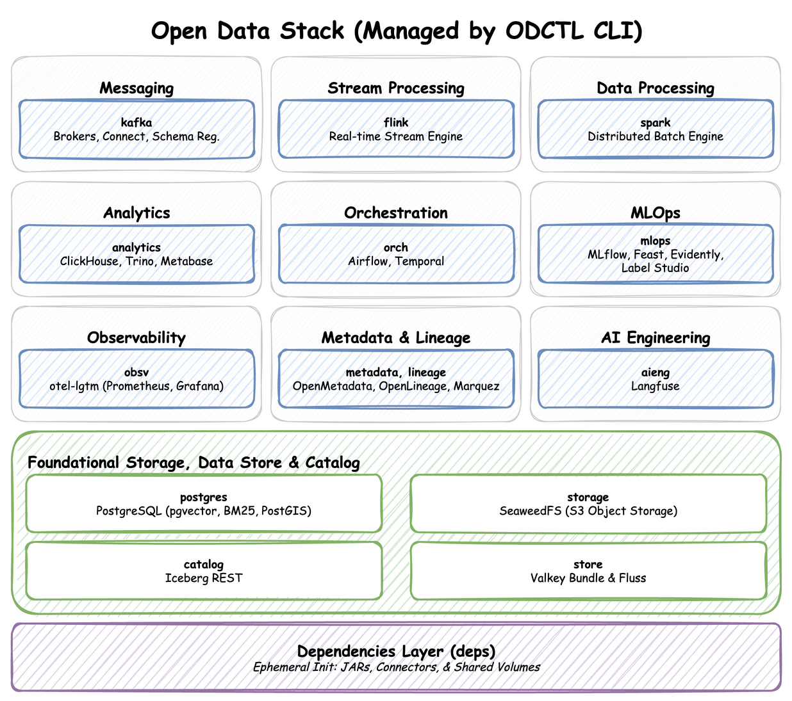

# Open Data Stack (odctl)

   

**Run an open data stack on your machine, with its services already connected, from one command.**



odctl is a command-line tool that runs an open data stack on your machine with Docker Compose: Kafka, Flink, Spark, Iceberg, Trino, ClickHouse, MLflow, Feast, Airflow and more. You name the profiles you want, such as `kafka-lite` or `airflow`, and odctl starts them together with the services they depend on.

To see why it exists and how it differs from a Compose file of your own, read [Why odctl](https://jaehyeon.me/odctl/latest/about/why-odctl/).

Documentation: [jaehyeon.me/odctl](https://jaehyeon.me/odctl/). It covers every profile with its ports, images and memory limits, the CLI reference, guides and troubleshooting.

## Installation

odctl needs Docker running and Python 3.10 or later. [Requirements](https://jaehyeon.me/odctl/latest/getting-started/#requirements) says how much memory to give Docker. Install odctl into its own environment:

```bash
uv tool install odctl
# or
pipx install odctl
```

## Quick Start

These commands create a workspace, list the profiles, start three of them and stop everything:

```bash
odctl init                    # copy the compose files and settings into ./.odctl
odctl list                    # show the profiles
odctl up kafka-lite flink-lite spark-lite
odctl down --all
```

`odctl up` starts the profiles each one depends on first, here PostgreSQL, SeaweedFS (S3) and the Iceberg REST catalog. See [Getting Started](https://jaehyeon.me/odctl/latest/getting-started/) for more.


## Commands

Each command has its own section in the CLI reference, with its options and examples. [Getting Started](https://jaehyeon.me/odctl/latest/getting-started/) runs them in order on one profile.

- **See the stack:** [`odctl list`](https://jaehyeon.me/odctl/latest/cli/#odctl-list) shows every profile, [`odctl explain`](https://jaehyeon.me/odctl/latest/cli/#odctl-explain) shows one profile's services, images and ports, [`odctl ps`](https://jaehyeon.me/odctl/latest/cli/#odctl-ps) shows the running containers, [`odctl info`](https://jaehyeon.me/odctl/latest/cli/#odctl-info) checks the odctl version and Docker, and [`odctl logs`](https://jaehyeon.me/odctl/latest/cli/#odctl-logs) reads a profile's logs. The first four print JSON with `--json`.
- **Run it:** [`odctl init`](https://jaehyeon.me/odctl/latest/cli/#odctl-init) copies the compose files and settings into `.odctl`, [`odctl pull`](https://jaehyeon.me/odctl/latest/cli/#odctl-pull) downloads images, [`odctl up`](https://jaehyeon.me/odctl/latest/cli/#odctl-up) starts profiles, [`odctl down`](https://jaehyeon.me/odctl/latest/cli/#odctl-down) stops them, [`odctl restart`](https://jaehyeon.me/odctl/latest/cli/#odctl-restart) restarts their containers, and [`odctl recreate`](https://jaehyeon.me/odctl/latest/cli/#odctl-recreate) replaces them to apply an edit.
- **AI agents:** [`odctl mcp`](https://jaehyeon.me/odctl/latest/cli/#odctl-mcp) gives an AI agent odctl's commands as MCP tools; it needs the `mcp` extra.

## AI Assistants

odctl has a plugin for Claude Code, Codex and Antigravity. It installs an agent skill, which tells an assistant which profile to start and how to reach each service, and the `odctl mcp` server, which gives it odctl's commands as tools and starts read-only. The plugin does not install odctl, so install it with the `mcp` extra first:

```bash
uv tool install 'odctl[mcp]'
# or, if you installed odctl with pipx
pipx install --force 'odctl[mcp]'
```

Then install the plugin with the line of your tool:

```bash
claude plugin marketplace add jaehyeon-kim/odctl && claude plugin install odctl@odctl   # Claude Code
codex plugin marketplace add jaehyeon-kim/odctl && codex plugin add odctl@odctl         # Codex
agy plugin install https://github.com/jaehyeon-kim/odctl                                # Antigravity
```

[AI Assistants](https://jaehyeon.me/odctl/latest/ai/) covers the plugin, the skill, the MCP server and `llms.txt`.

## Roadmap

odctl follows semantic versioning from 1.0, so a later 1.x release does not break a project that pins `odctl>=1.0,<2`; [What Stays Stable in 1.x](https://jaehyeon.me/odctl/latest/how-it-works/#what-stays-stable-in-1x) lists what that covers. The [roadmap page](https://jaehyeon.me/odctl/latest/about/roadmap/) shows the work being built and the work planned.

## Related Reading

Blog posts about odctl and the projects built on it are tagged [odctl](https://jaehyeon.me/tags/odctl/) on jaehyeon.me.

Projects that use odctl:

- [benchtop](https://github.com/jaehyeon-kim/benchtop): hands-on data engineering and machine learning demos that run locally, each on the odctl stack.
- [desflow](https://github.com/jaehyeon-kim/desflow) ([docs](https://jaehyeon.me/desflow/)): a SimPy library for simulations that stream to Kafka, PostgreSQL, Redis and Iceberg; its examples and integration tests run their infrastructure with odctl.
- [agentic-analytics-system](https://github.com/jaehyeon-kim/agentic-analytics-system): conversational analytics over an Iceberg lakehouse, with Trino, Iceberg and object storage started by odctl.

## Contributing

Pull requests are welcome. [CONTRIBUTING.md](https://github.com/jaehyeon-kim/odctl/blob/main/CONTRIBUTING.md) explains how to set up the repository, run the tests, add a profile or a command, and write the docs.

## License

This project is licensed under the Apache License 2.0. See the [LICENSE](LICENSE) file for details.
