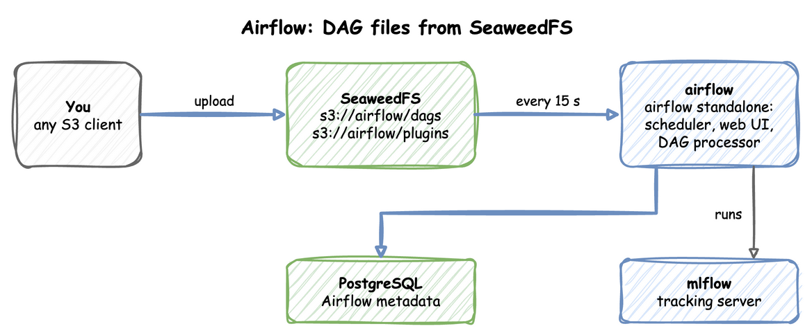
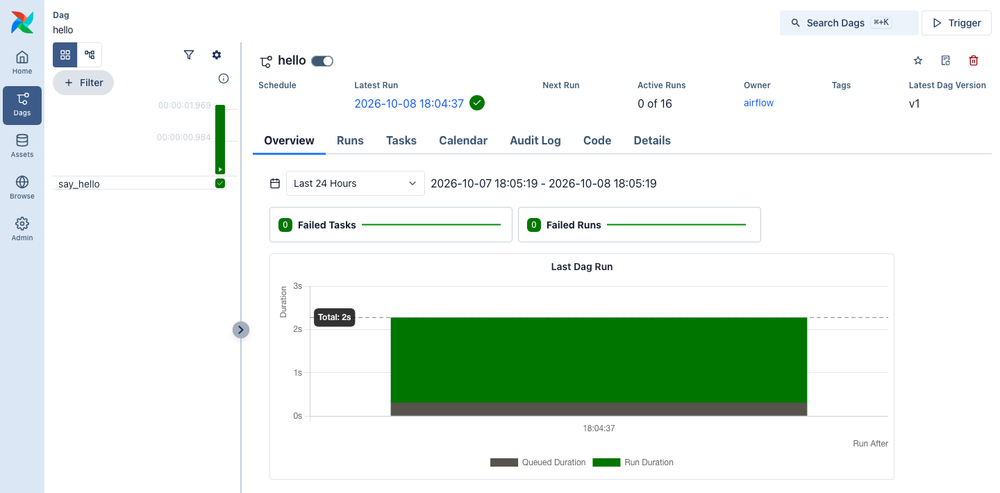

# Airflow DAGs from S3

The `airflow` profile runs `airflow standalone` in one container against odctl's PostgreSQL. It reads DAG files from `s3://airflow/dags` on SeaweedFS, so you deploy a DAG by uploading it. No volume or sync container is involved. The end-to-end tests run the steps below on every release.

This guide builds on [Getting Started](../getting-started.md). Look at the left of the diagram: DAG files go to SeaweedFS, and Airflow reads them from there.



Start the profile:

```bash title="docs/snippets/airflow-dags/commands.sh:up"
odctl up airflow
```

| Endpoint | Address |
| --- | --- |
| Web UI and REST API from the host | `http://127.0.0.1:8085`, user `user`, password `password` |
| Web UI and REST API inside the `odctl` network | `http://airflow:8080` |
| DAG folder | `s3://airflow/dags` on SeaweedFS |

## Upload a DAG

Any S3 client pointed at `http://127.0.0.1:8333` with key `user` and secret `password` can upload. This uses boto3 inside the Airflow container to write the DAG `hello`, with one task that runs `echo hello`:

```bash title="docs/snippets/airflow-dags/commands.sh:upload"
docker exec -i airflow python - <<'PY'
import boto3
body = '''
from airflow.sdk import DAG
from airflow.providers.standard.operators.bash import BashOperator
import pendulum

with DAG(
    dag_id="hello",
    start_date=pendulum.datetime(2026, 1, 1, tz="UTC"),
    schedule=None,
    catchup=False,
):
    BashOperator(task_id="say_hello", bash_command="echo hello")
'''
boto3.client("s3", endpoint_url="http://seaweed:8333").put_object(
    Bucket="airflow", Key="dags/hello.py", Body=body.encode())
PY
```

The upload prints nothing. Airflow checks the bucket every 15 seconds and then parses the new file. The interval is set today by `refresh_interval` in `AIRFLOW__DAG_PROCESSOR__DAG_BUNDLE_CONFIG_LIST` in `.odctl/compose-orch.yml`, where an edit can change it.

## Run It

New DAGs start paused. Wait until the DAG is listed, then unpause it, trigger it and list its runs:

```bash title="docs/snippets/airflow-dags/commands.sh:run"
docker exec airflow airflow dags list | grep hello
docker exec airflow airflow dags unpause hello
docker exec airflow airflow dags trigger hello
docker exec airflow airflow dags list-runs hello
```

The first command prints the `hello` line of the list. The last lists the run with its `run_id`, such as `manual__2026-10-24T04:55:03.340843+00:00`, in state `queued` or `running`, and listing it again a few seconds later shows `success`. The DAG page shows the run and the `say_hello` task.

{ .screenshot }

## Plugins and Packages

Plugins are copied from `s3://airflow/plugins` when the container starts, because Airflow loads plugins only once. Run `odctl restart airflow` after changing one.

Tasks already have the MLflow and Feast clients, and `MLFLOW_TRACKING_URI` points at the `mlflow` profile. [How It Works](../how-it-works.md#examples) shows how to install extra Python packages with `_AIRFLOW_PIP_DEPS`.

## From Another Container

Inside the [`odctl` network](../how-it-works.md#how-you-reach-a-service), the Airflow API is `http://airflow:8080`, and tasks reach SeaweedFS at `http://seaweed:8333` and MLflow at `http://mlflow:5000`.

## Runnable Example

Save this file as `example.sh` and run it with `bash example.sh` in the folder that holds your `.odctl` workspace. It runs the steps above and waits for each one:

```bash title="docs/snippets/airflow-dags/example.sh"
#!/usr/bin/env bash
# Starts airflow, uploads a DAG to s3://airflow/dags, waits until Airflow has
# parsed it, triggers a run and waits until the run finishes.
set -euo pipefail

odctl up airflow

docker exec -i airflow python - <<'PY'
import boto3
body = '''
from airflow.sdk import DAG
from airflow.providers.standard.operators.bash import BashOperator
import pendulum

with DAG(
    dag_id="hello",
    start_date=pendulum.datetime(2026, 1, 1, tz="UTC"),
    schedule=None,
    catchup=False,
):
    BashOperator(task_id="say_hello", bash_command="echo hello")
'''
boto3.client("s3", endpoint_url="http://seaweed:8333").put_object(
    Bucket="airflow", Key="dags/hello.py", Body=body.encode())
PY

# Airflow checks the bucket every 15 seconds, then parses the new file.
until docker exec airflow airflow dags list 2>/dev/null | grep hello >/dev/null; do sleep 5; done
docker exec airflow airflow dags unpause hello
docker exec airflow airflow dags trigger hello >/dev/null

until docker exec airflow airflow dags list-runs hello -o plain 2>/dev/null | grep -E 'success|failed' >/dev/null; do sleep 5; done
docker exec airflow airflow dags list-runs hello -o plain
```

It prints the `hello` line from `airflow dags unpause` and then the run, in state `success`.
