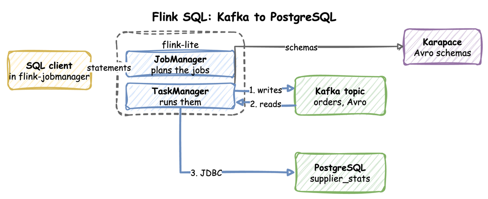
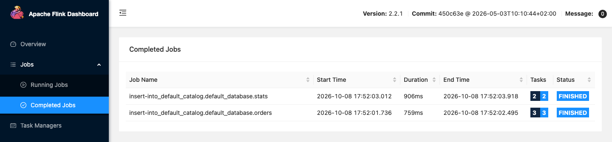

# Flink SQL: Kafka to PostgreSQL

The `flink-lite` profile runs a Flink JobManager, one TaskManager and the SQL Gateway. `flink-full` runs three TaskManagers. Flink's connector jars for Kafka, Avro with the schema registry, JDBC, Iceberg and HTTP come from the shared volume that the `deps` profile fills. The end-to-end tests run the commands below on every release.

This guide reads Avro records from Kafka through the Karapace schema registry and writes an aggregate to PostgreSQL over JDBC. [Ingest into Iceberg](iceberg-ingestion.md) shows Flink writing an Iceberg table.



```bash
odctl up flink-lite kafka-lite
```

`flink-lite` starts PostgreSQL itself, because it depends on the Iceberg catalog, which keeps its metadata there.

| Endpoint | Address |
| --- | --- |
| Flink UI and REST API from the host | `http://127.0.0.1:8082` |
| SQL Gateway REST API from the host | `http://127.0.0.1:8084` |
| Flink REST API inside the `odctl` network | `http://jobmanager:8081` |
| SQL Gateway inside the `odctl` network | `http://flink-sql-gateway:8083` |

## Create the topic and the target table

```bash title="docs/snippets/flink-sql/commands.sh:create-topic-table"
docker exec kafka /opt/kafka/bin/kafka-topics.sh --bootstrap-server broker-1:19092 \
  --create --if-not-exists --topic orders --partitions 1 --replication-factor 1

docker exec postgres psql -U user -d odctl -c "
  CREATE TABLE supplier_stats (supplier TEXT PRIMARY KEY, orders BIGINT, total DOUBLE PRECISION);"
```

## Run the SQL

Open the SQL client in the JobManager container:

```bash title="docs/snippets/flink-sql/commands.sh:sql-client"
docker exec -it flink-jobmanager /opt/flink/bin/sql-client.sh
```

```sql title="docs/snippets/flink-sql/steps.sql:kafka-to-postgres"
SET 'execution.runtime-mode' = 'batch';
SET 'table.dml-sync' = 'true';
CREATE TABLE orders (supplier STRING, price DOUBLE) WITH ('connector'='kafka','topic'='orders','properties.bootstrap.servers'='broker-1:19092','scan.startup.mode'='earliest-offset','scan.bounded.mode'='latest-offset','format'='avro-confluent','avro-confluent.url'='http://karapace:8081');
INSERT INTO orders VALUES ('a', 10.0), ('a', 5.0), ('b', 7.5);
CREATE TABLE stats (supplier STRING, orders BIGINT, total DOUBLE, PRIMARY KEY (supplier) NOT ENFORCED) WITH ('connector'='jdbc','url'='jdbc:postgresql://postgres:5432/odctl','table-name'='supplier_stats','username'='user','password'='password');
INSERT INTO stats SELECT supplier, COUNT(*), SUM(price) FROM orders GROUP BY supplier;
```

The first `INSERT` writes three Avro records to Kafka and registers their schema in Karapace. The second reads them back, groups them by supplier and writes the result to PostgreSQL. `scan.bounded.mode` set to `latest-offset` makes the Kafka source stop at the end of the topic, so the batch job finishes. Leave it out and set `execution.runtime-mode` to `streaming` for a job that keeps running.

Right after Kafka starts, Karapace can answer its health check and still time out on a schema write for a short while. If the first `INSERT` fails on the schema registry, run it again.

## Check the result

```bash title="docs/snippets/flink-sql/commands.sh:check"
docker exec postgres psql -U user -d odctl -c "SELECT * FROM supplier_stats ORDER BY supplier"
```

Supplier `a` has 2 orders totalling 15, and supplier `b` has 1 order totalling 7.5. The Flink UI at `http://127.0.0.1:8082` shows the jobs the SQL client submitted.

The two `INSERT` statements run as two batch jobs, listed under Completed Jobs.

{ .screenshot }

## Send rows to an HTTP API

The HTTP connector sends rows to a URL. This section pushes a feature value to Feast, which takes it at `/push` and serves it from its online store.

```bash
odctl up feast
```

Feast needs a push source before it accepts a push. Save these definitions as `definitions.py`:

```python title="docs/snippets/flink-sql/definitions.py"
from datetime import timedelta
from feast import Entity, FeatureView, Field, FileSource, PushSource
from feast.types import Float32, Int64
from feast.value_type import ValueType

driver = Entity(name="driver", join_keys=["driver_id"], value_type=ValueType.INT64)
# Nothing reads this file. A push source needs a batch source behind it.
batch = FileSource(path="/tmp/driver_stats.parquet", timestamp_field="event_timestamp")
push = PushSource(name="driver_stats_push", batch_source=batch)
driver_stats = FeatureView(
    name="driver_stats",
    entities=[driver],
    ttl=timedelta(days=1),
    schema=[Field(name="driver_id", dtype=Int64), Field(name="conv_rate", dtype=Float32)],
    source=push,
    online=True,
)
```

Copy the definitions into the Feast container and apply them. `--skip-source-validation` stops Feast from looking for the file behind the batch source:

```bash title="docs/snippets/flink-sql/commands.sh:feast-apply"
docker cp definitions.py feast-serve:/tmp/feature_repo/definitions.py
docker exec feast-serve feast -c /tmp/feature_repo apply --skip-source-validation
```

Open the SQL client as above and run these statements:

```sql title="docs/snippets/flink-sql/steps.sql:feast-push"
SET 'execution.runtime-mode' = 'batch';
SET 'table.dml-sync' = 'true';
CREATE TABLE feast_push (
  push_source_name STRING,
  df ROW<driver_id ARRAY<BIGINT>, conv_rate ARRAY<DOUBLE>, event_timestamp ARRAY<TIMESTAMP_LTZ(3)>>,
  allow_registry_cache BOOLEAN
) WITH (
  'connector' = 'http-async-sink',
  'url' = 'http://feast-serve:6566/push',
  'format' = 'json',
  'http.sink.writer.request.mode' = 'single',
  'http.sink.header.Content-Type' = 'application/json'
);
INSERT INTO feast_push SELECT 'driver_stats_push', ROW(ARRAY[CAST(1001 AS BIGINT)], ARRAY[CAST(0.9 AS DOUBLE)], ARRAY[CURRENT_TIMESTAMP]), FALSE;
```

The connector is `http-async-sink`. Its default sends rows in batches as one JSON array. Feast's `/push` takes one JSON object, so `http.sink.writer.request.mode` is `single`, which sends one request for each row. The sink sends no `Content-Type` header, and Feast answers 422 without one, so `http.sink.header.Content-Type` sets it. The column names are the field names of the request body. Feast reads `df` as a table of columns, so each field holds an array.

Feast caches its registry for up to a minute after `apply`. `allow_registry_cache` set to `FALSE` makes the push read the registry again, so it works at once. The timestamp must be new: a push with the same `event_timestamp` as the stored value does not replace it, so the statement uses `CURRENT_TIMESTAMP`.

The Flink job finishes and prints `Complete execution` even when Feast rejects the request. The failure is only in the TaskManager log as `Http Sink failed to write`. Read the value back from Feast to check the push:

```bash title="docs/snippets/flink-sql/commands.sh:feast-read"
curl -s -X POST http://127.0.0.1:6566/get-online-features \
  -H 'Content-Type: application/json' \
  -d '{"features": ["driver_stats:conv_rate"], "entities": {"driver_id": [1001]}}'
```

The answer holds `0.8999999761581421` for `conv_rate`, which is 0.9 as a 32-bit float. The read also uses the cached registry, so right after `apply` it can answer that the feature view does not exist. Run it again after a minute.

## Several rolling windows

A feature such as the sum of a card's payments over 10 minutes, 1 hour and 1 day needs one rolling window for each size. A streaming query cannot hold two different `OVER` windows. Flink's documentation says that for streaming queries the `OVER` windows of all aggregates in one `SELECT` must be identical ([Over aggregation](https://github.com/apache/flink/blob/release-2.2/docs/content/docs/dev/table/sql/queries/over-agg.md), Flink 2.2). Run this in the SQL client to see Flink refuse a query with a 10 minute and a 1 hour window:

```sql title="docs/snippets/flink-sql/steps.sql:windows-refused"
SET 'execution.runtime-mode' = 'streaming';
CREATE TABLE payments (card BIGINT, amount DOUBLE, seq BIGINT, ts AS TO_TIMESTAMP_LTZ(seq * 60000, 3), WATERMARK FOR ts AS ts) WITH ('connector'='datagen','fields.seq.kind'='sequence','fields.seq.start'='1','fields.seq.end'='20','fields.card.min'='1','fields.card.max'='2','fields.amount.min'='1','fields.amount.max'='10');
SELECT card,
  SUM(amount) OVER (PARTITION BY card ORDER BY ts RANGE BETWEEN INTERVAL '10' MINUTE PRECEDING AND CURRENT ROW) AS sum_10m,
  SUM(amount) OVER (PARTITION BY card ORDER BY ts RANGE BETWEEN INTERVAL '1' HOUR PRECEDING AND CURRENT ROW) AS sum_1h
FROM payments;
```

The client prints `[ERROR] Could not execute SQL statement.` with this reason:

```text
org.apache.flink.table.api.TableException: Over Agg: Unsupported use of OVER windows. All aggregates must be computed on the same window. please re-check the over window statement.
```

The first route is one statement for each window size, each writing its own table. Create the two PostgreSQL tables:

```bash title="docs/snippets/flink-sql/commands.sh:create-window-tables"
docker exec postgres psql -U user -d odctl -c "
  CREATE TABLE card_sum_10m (card BIGINT, amount_sum DOUBLE PRECISION);
  CREATE TABLE card_sum_1h (card BIGINT, amount_sum DOUBLE PRECISION);"
```

Then run the two statements in a new SQL client session. The `sequence` field makes the source stop after 20 rows, and the event time `ts` makes each job write every row before it finishes. An `OVER` window on `PROCTIME()` would lose the rows still waiting for their timer when a bounded source ends:

```sql title="docs/snippets/flink-sql/steps.sql:windows-one-per-size"
SET 'execution.runtime-mode' = 'streaming';
SET 'table.dml-sync' = 'true';
CREATE TABLE payments (card BIGINT, amount DOUBLE, seq BIGINT, ts AS TO_TIMESTAMP_LTZ(seq * 60000, 3), WATERMARK FOR ts AS ts) WITH ('connector'='datagen','fields.seq.kind'='sequence','fields.seq.start'='1','fields.seq.end'='20','fields.card.min'='1','fields.card.max'='2','fields.amount.min'='1','fields.amount.max'='10');
CREATE TABLE sum_10m (card BIGINT, amount_sum DOUBLE) WITH ('connector'='jdbc','url'='jdbc:postgresql://postgres:5432/odctl','table-name'='card_sum_10m','username'='user','password'='password');
CREATE TABLE sum_1h (card BIGINT, amount_sum DOUBLE) WITH ('connector'='jdbc','url'='jdbc:postgresql://postgres:5432/odctl','table-name'='card_sum_1h','username'='user','password'='password');
INSERT INTO sum_10m SELECT card, SUM(amount) OVER (PARTITION BY card ORDER BY ts RANGE BETWEEN INTERVAL '10' MINUTE PRECEDING AND CURRENT ROW) FROM payments;
INSERT INTO sum_1h SELECT card, SUM(amount) OVER (PARTITION BY card ORDER BY ts RANGE BETWEEN INTERVAL '1' HOUR PRECEDING AND CURRENT ROW) FROM payments;
```

Each table holds 20 rows:

```bash title="docs/snippets/flink-sql/commands.sh:check-windows"
docker exec postgres psql -U user -d odctl -c "
  SELECT (SELECT count(*) FROM card_sum_10m) AS rows_10m, (SELECT count(*) FROM card_sum_1h) AS rows_1h"
```

The cost is one job for each window size, each reading the source again, and one table for each size that a reader has to join on the key. With four sizes that is four jobs.

The second route is one `KeyedProcessFunction` in the DataStream API, which keeps the events of the longest window in Flink state and computes every size from them. This sketch is not run by the end-to-end tests:

```python title="docs/snippets/flink-sql/keyed_sketch.py:keyed-sketch"
from pyflink.common import Types
from pyflink.datastream.functions import KeyedProcessFunction, RuntimeContext
from pyflink.datastream.state import ListStateDescriptor

WINDOWS_MS = {"10m": 600_000, "1h": 3_600_000, "1d": 86_400_000, "7d": 604_800_000}


class RollingSums(KeyedProcessFunction):
    def open(self, runtime_context: RuntimeContext):
        # Every event of the longest window, for each key, kept in Flink state.
        self.events = runtime_context.get_list_state(
            ListStateDescriptor("events", Types.TUPLE([Types.LONG(), Types.DOUBLE()]))
        )

    def process_element(self, value, ctx):
        now = ctx.timestamp()
        kept = [(t, a) for t, a in self.events.get() if now - t <= WINDOWS_MS["7d"]]
        kept.append((now, value[1]))
        self.events.update(kept)
        yield value[0], {n: sum(a for t, a in kept if now - t <= ms) for n, ms in WINDOWS_MS.items()}
```

One job computes all sizes, but you write and test the code in Python or Java instead of SQL, and you manage the state, which grows with the events of the longest window for each key.

## From another container

Inside the [`odctl` network](../how-it-works.md#how-you-reach-a-service), Flink's REST API is `http://jobmanager:8081` and the SQL Gateway is `http://flink-sql-gateway:8083`. In Flink SQL, Kafka is `broker-1:19092`, Karapace is `http://karapace:8081` and PostgreSQL is `jdbc:postgresql://postgres:5432/odctl`.
