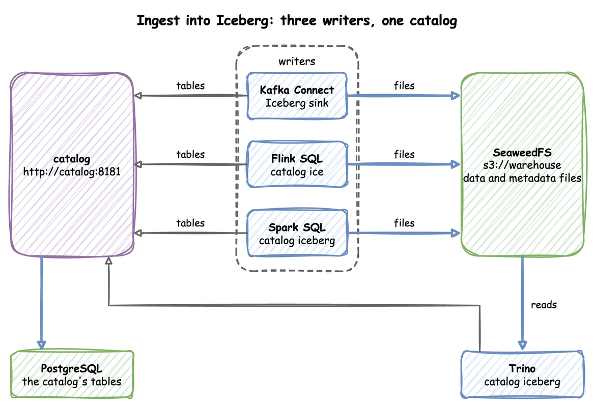
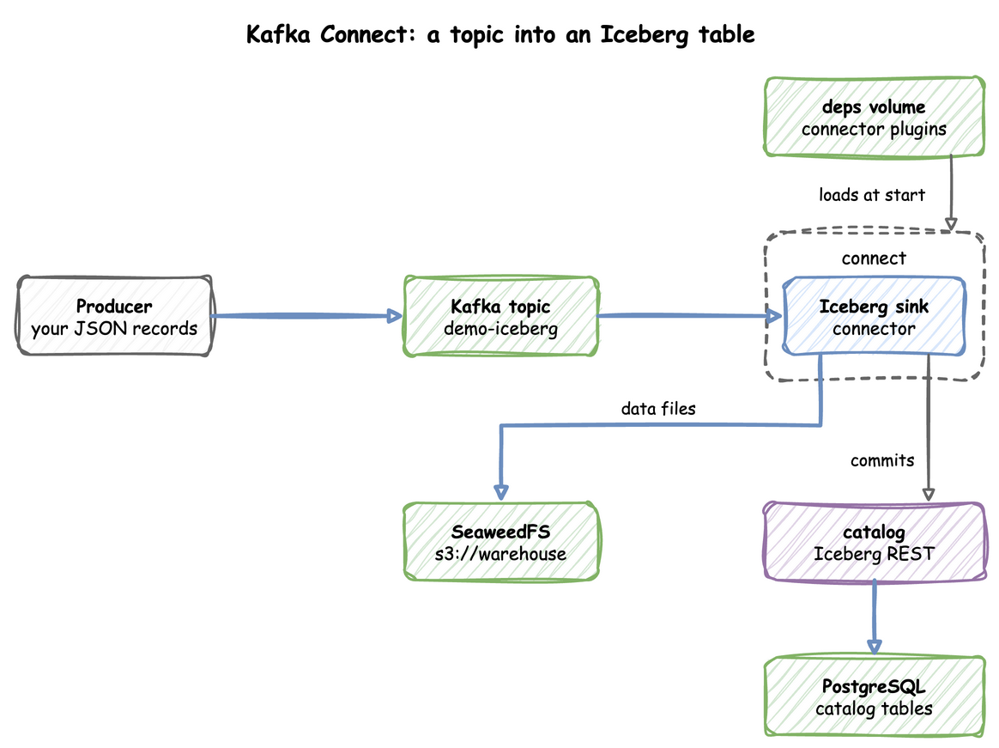
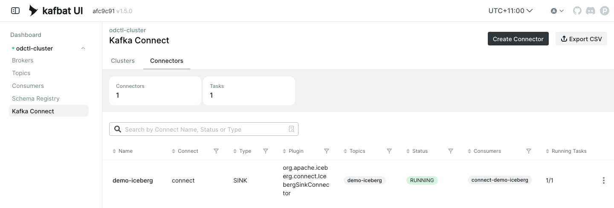
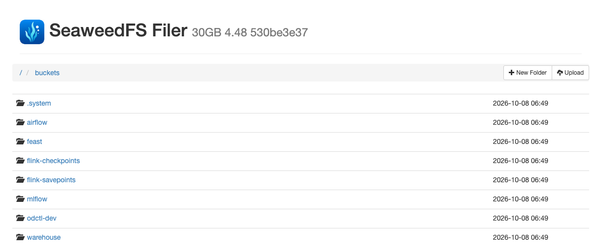

# Ingest into Iceberg

Kafka Connect, Flink and Spark all write Iceberg tables through the same REST catalog, `http://catalog:8181`, with the files on SeaweedFS under `s3://warehouse`. SeaweedFS is an object store with an S3 API, which odctl's `storage` profile runs. The end-to-end tests run the commands below on every release.

This guide builds on [Kafka Connect](kafka-connect.md), which registers a connector, and [Flink SQL](flink-sql.md), which runs statements in the SQL client.



`kafka-lite` does not start the catalog, so start both:

```bash title="docs/snippets/iceberg-ingestion/commands.sh:up"
odctl up kafka-lite catalog
```

| Endpoint | Address |
| --- | --- |
| Catalog REST API from the host | `http://127.0.0.1:8181` |
| Catalog REST API inside the `odctl` network | `http://catalog:8181` |
| SeaweedFS S3 API from the host | `http://127.0.0.1:8333` |
| SeaweedFS S3 API inside the `odctl` network | `http://seaweed:8333` |
| SeaweedFS file browser | `http://127.0.0.1:8889` |

## Kafka Connect Sink

The Iceberg sink in Kafka Connect reads a topic and commits its records to an Iceberg table through the catalog. Look at the sink in the middle: it writes data files to SeaweedFS and commits each batch through the catalog, which keeps its tables in PostgreSQL.



The sink writes to a table that exists. This creates the namespace `demo` and the table `kc` through the catalog's REST API:

```bash title="docs/snippets/iceberg-ingestion/commands.sh:create-table"
api=http://127.0.0.1:8181/v1/namespaces
curl -X POST -H 'Content-Type: application/json' -d '{"namespace":["demo"]}' "$api"
curl -X POST -H 'Content-Type: application/json' \
  -d '{"name":"kc","schema":{"type":"struct","schema-id":0,"fields":[{"id":1,"name":"id","required":false,"type":"long"},{"id":2,"name":"name","required":false,"type":"string"}]}}' \
  "$api/demo/tables"
```

Each call answers with the namespace or the table's metadata as JSON. The sink also needs its topic and a control topic, where its tasks agree on each commit. This creates both and writes five JSON records:

```bash title="docs/snippets/iceberg-ingestion/commands.sh:topics-produce"
for topic in demo-iceberg control-iceberg; do
  docker exec kafka /opt/kafka/bin/kafka-topics.sh --bootstrap-server broker-1:19092 \
    --create --if-not-exists --topic "$topic" --partitions 1 --replication-factor 1
done
for i in 1 2 3 4 5; do echo "{\"id\":$i,\"name\":\"n$i\"}"; done | docker exec -i kafka \
  /opt/kafka/bin/kafka-console-producer.sh --bootstrap-server broker-1:19092 --topic demo-iceberg
```

Save the sink's configuration as `demo-iceberg.json`. It reads plain JSON, so it sets `"value.converter.schemas.enable": "false"` instead of the worker's default:

```json title="docs/snippets/iceberg-ingestion/demo-iceberg.json"
{
  "name": "demo-iceberg",
  "config": {
    "connector.class": "org.apache.iceberg.connect.IcebergSinkConnector",
    "tasks.max": "1",
    "topics": "demo-iceberg",
    "value.converter": "org.apache.kafka.connect.json.JsonConverter",
    "value.converter.schemas.enable": "false",
    "key.converter": "org.apache.kafka.connect.storage.StringConverter",
    "iceberg.tables": "demo.kc",
    "iceberg.control.commit.interval-ms": "10000",
    "iceberg.kafka.session.timeout.ms": "300000",
    "iceberg.kafka.heartbeat.interval.ms": "3000",
    "iceberg.kafka.auto.offset.reset": "earliest",
    "consumer.override.auto.offset.reset": "earliest",
    "iceberg.catalog.type": "rest",
    "iceberg.catalog.uri": "http://catalog:8181",
    "iceberg.catalog.io-impl": "org.apache.iceberg.aws.s3.S3FileIO",
    "iceberg.catalog.client.region": "us-east-1",
    "iceberg.catalog.s3.endpoint": "http://seaweed:8333",
    "iceberg.catalog.s3.path-style-access": "true",
    "iceberg.catalog.s3.access-key-id": "user",
    "iceberg.catalog.s3.secret-access-key": "password"
  }
}
```

Register it with Kafka Connect from the folder that holds the file:

```bash title="docs/snippets/iceberg-ingestion/commands.sh:register"
curl -X POST -H 'Content-Type: application/json' \
  http://127.0.0.1:8083/connectors -d @demo-iceberg.json
```

The first commit can take a minute or more, because the sink waits for its control consumer to join a group. After that, the table's current snapshot counts the five records:

```bash title="docs/snippets/iceberg-ingestion/commands.sh:records"
curl -s http://127.0.0.1:8181/v1/namespaces/demo/tables/kc | grep -o '"total-records":"[0-9]*"'
```

The command prints `"total-records":"5"`. Then check the connector and remove it:

```bash title="docs/snippets/iceberg-ingestion/commands.sh:status-remove"
curl -s http://127.0.0.1:8083/connectors/demo-iceberg/status
curl -X DELETE http://127.0.0.1:8083/connectors/demo-iceberg
```

The status shows `"state":"RUNNING"` for the connector and its task. Kafka UI lists the sink under Kafka Connect, Connectors while it is registered:

{ .screenshot }

The table's data and metadata files are in SeaweedFS, whose browser at `http://127.0.0.1:8889` lists the buckets, including `warehouse`.

{ .screenshot }

## Flink SQL

Start Flink and open its SQL client. `flink-lite` uses the catalog that is already running:

```bash title="docs/snippets/iceberg-ingestion/commands.sh:flink-client"
odctl up flink-lite
docker exec -it flink-jobmanager /opt/flink/bin/sql-client.sh
```

These statements register the catalog as `ice`, create a table, insert three rows and count them:

```sql title="docs/snippets/iceberg-ingestion/steps.sql:flink"
SET 'execution.runtime-mode' = 'batch';
SET 'table.dml-sync' = 'true';
SET 'sql-client.execution.result-mode' = 'tableau';
CREATE CATALOG ice WITH ('type'='iceberg','catalog-type'='rest','uri'='http://catalog:8181','warehouse'='s3://warehouse','s3.endpoint'='http://seaweed:8333','s3.path-style-access'='true','s3.access-key-id'='user','s3.secret-access-key'='password');
CREATE DATABASE IF NOT EXISTS ice.demo_flink;
CREATE TABLE ice.demo_flink.t (id BIGINT, name STRING);
INSERT INTO ice.demo_flink.t VALUES (1, 'a'), (2, 'b'), (3, 'c');
SELECT COUNT(*) FROM ice.demo_flink.t;
```

The `SELECT` prints `3`.

## Spark SQL

Spark's default catalog already points at the same REST catalog, as [Spark](spark.md#run-sql-against-iceberg) shows when it creates and queries a table.

Every engine sees the same tables, so a table written by one can be read by the others, and by Trino through its `iceberg` catalog.

## From Another Container

Inside the [`odctl` network](../how-it-works.md#how-you-reach-a-service), an Iceberg client uses the catalog at `http://catalog:8181`, the warehouse `s3://warehouse`, and SeaweedFS at `http://seaweed:8333` with the key `user` and the secret `password`.

## Runnable Example

Save this file as `example.sh` and run it with `bash example.sh` in the folder that holds your `.odctl` workspace. It runs the Kafka Connect sink and the Flink SQL steps above with names of its own for each run, so it can run again:

```bash title="docs/snippets/iceberg-ingestion/example.sh"
#!/usr/bin/env bash
# Starts kafka-lite and flink-lite, which starts the catalog, then writes five
# rows to an Iceberg table through the Kafka Connect sink and three rows to
# another through Flink SQL, and prints both counts. Each run uses its own
# topic, connector and table names, so the file can run again.
set -euo pipefail

odctl up kafka-lite flink-lite

run=$(date +%s)
api=http://127.0.0.1:8181/v1/namespaces
until curl -fs http://127.0.0.1:8083/connectors >/dev/null; do sleep 2; done

# A namespace, which may exist already, and an empty table for the sink.
curl -s -o /dev/null -X POST -H 'Content-Type: application/json' -d '{"namespace":["demo"]}' "$api"
curl -fs -o /dev/null -X POST -H 'Content-Type: application/json' \
  -d "{\"name\":\"kc_$run\",\"schema\":{\"type\":\"struct\",\"schema-id\":0,\"fields\":[{\"id\":1,\"name\":\"id\",\"required\":false,\"type\":\"long\"},{\"id\":2,\"name\":\"name\",\"required\":false,\"type\":\"string\"}]}}" \
  "$api/demo/tables"

# Create the topic and the sink's control topic, then write five JSON records.
for topic in "iceberg-$run" "control-$run"; do
  docker exec kafka /opt/kafka/bin/kafka-topics.sh --bootstrap-server broker-1:19092 \
    --create --topic "$topic" --partitions 1 --replication-factor 1
done
for i in 1 2 3 4 5; do echo "{\"id\":$i,\"name\":\"n$i\"}"; done | docker exec -i kafka \
  /opt/kafka/bin/kafka-console-producer.sh --bootstrap-server broker-1:19092 --topic "iceberg-$run"

curl -fs -o /dev/null -X POST -H 'Content-Type: application/json' http://127.0.0.1:8083/connectors -d @- <<JSON
{
  "name": "iceberg-$run",
  "config": {
    "connector.class": "org.apache.iceberg.connect.IcebergSinkConnector",
    "tasks.max": "1",
    "topics": "iceberg-$run",
    "value.converter": "org.apache.kafka.connect.json.JsonConverter",
    "value.converter.schemas.enable": "false",
    "key.converter": "org.apache.kafka.connect.storage.StringConverter",
    "iceberg.tables": "demo.kc_$run",
    "iceberg.control.topic": "control-$run",
    "iceberg.control.commit.interval-ms": "10000",
    "iceberg.kafka.session.timeout.ms": "300000",
    "iceberg.kafka.heartbeat.interval.ms": "3000",
    "iceberg.kafka.auto.offset.reset": "earliest",
    "consumer.override.auto.offset.reset": "earliest",
    "iceberg.catalog.type": "rest",
    "iceberg.catalog.uri": "http://catalog:8181",
    "iceberg.catalog.io-impl": "org.apache.iceberg.aws.s3.S3FileIO",
    "iceberg.catalog.client.region": "us-east-1",
    "iceberg.catalog.s3.endpoint": "http://seaweed:8333",
    "iceberg.catalog.s3.path-style-access": "true",
    "iceberg.catalog.s3.access-key-id": "user",
    "iceberg.catalog.s3.secret-access-key": "password"
  }
}
JSON

# The first commit can take a minute or more.
until curl -s "$api/demo/tables/kc_$run" | grep '"total-records":"5"' >/dev/null; do sleep 5; done
echo "demo.kc_$run: 5 records written by the Kafka Connect sink"
curl -s -o /dev/null -X DELETE "http://127.0.0.1:8083/connectors/iceberg-$run"

docker exec -i flink-jobmanager /opt/flink/bin/sql-client.sh <<SQL | grep -E '^[|+]'
SET 'execution.runtime-mode' = 'batch';
SET 'table.dml-sync' = 'true';
SET 'sql-client.execution.result-mode' = 'tableau';
CREATE CATALOG ice WITH ('type'='iceberg','catalog-type'='rest','uri'='http://catalog:8181','warehouse'='s3://warehouse','s3.endpoint'='http://seaweed:8333','s3.path-style-access'='true','s3.access-key-id'='user','s3.secret-access-key'='password');
CREATE DATABASE IF NOT EXISTS ice.demo_flink;
CREATE TABLE ice.demo_flink.t_$run (id BIGINT, name STRING);
INSERT INTO ice.demo_flink.t_$run VALUES (1, 'a'), (2, 'b'), (3, 'c');
SELECT COUNT(*) AS flink_rows FROM ice.demo_flink.t_$run;
SQL
```

It prints `5 records written by the Kafka Connect sink` with the table's name, then a table with `flink_rows` equal to `3`. The SQL client also prints warnings about the JVM and the terminal on its error output, which do not affect the result.
