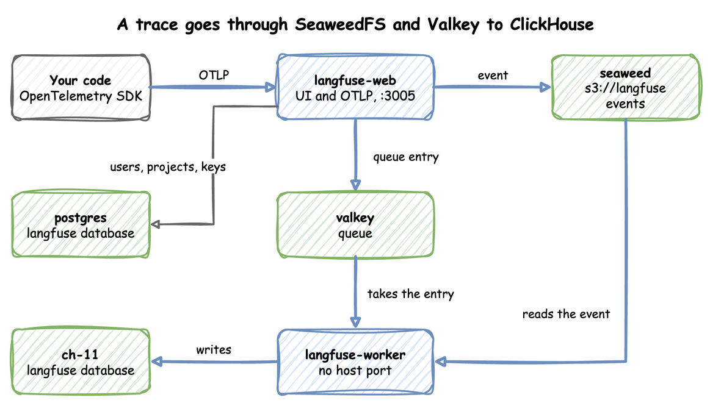
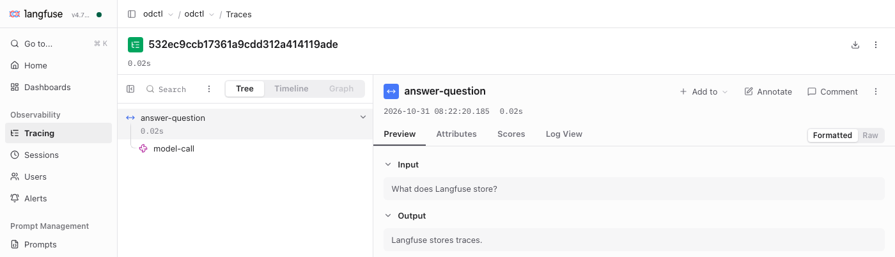

# Tracing LLM Apps with Langfuse

The `langfuse` profile runs Langfuse, which traces and evaluates applications built on LLMs (large language models) and agents. An application sends Langfuse one trace for each request: the record of what it did to answer, such as a call to a model. OpenTelemetry is an open standard for traces, metrics and logs; it calls each step of a trace a span. Langfuse stores each span it receives as an observation.

The profile runs Langfuse 4. It has `langfuse-web`, which serves the UI and receives traces, and `langfuse-worker`, which processes them. Both use odctl's PostgreSQL, SeaweedFS, Valkey and `ch-lite` (ClickHouse), which `odctl up` starts first. An application sends traces over OTLP, the protocol that the [Telemetry guide](telemetry.md) describes.

This guide builds on [Getting Started](../getting-started.md). The Send to Telemetry Too section also builds on the [Telemetry guide](telemetry.md). Run the commands in the folder that holds your `.odctl` workspace. Start the profile:

```bash title="docs/snippets/langfuse/commands.sh:up"
odctl up langfuse
```

| Endpoint | Address |
| --- | --- |
| UI from the host (user `user@odctl.io`, password `password`) | `http://127.0.0.1:3005` |
| OTLP endpoint from the host | `http://127.0.0.1:3005/api/public/otel` |
| OTLP endpoint inside the `odctl` network | `http://langfuse-web:3000/api/public/otel` |
| Project keys | public `pk-lf-odctl`, secret `sk-lf-odctl` |

Three facts about the profile:

- It starts `ch-lite`, whose two ClickHouse servers have a limit of 4 GB each, set by `mem_limit` in `.odctl/compose-analytics.yml`.
- Langfuse needs its databases in UTC, so keep `TZ` in `.odctl/.env` at its default, `UTC`.
- `ch-lite` and `ch-full` use the same container names, so stop `ch-full` with `odctl down ch-full` before `odctl up langfuse`.

PostgreSQL reads `TZ` only when it creates its data folder, as [How It Works](../how-it-works.md#examples) explains.

A trace takes this path. `langfuse-web` writes each event it receives to SeaweedFS and puts a reference on a Valkey queue. `langfuse-worker` takes the reference, reads the event and writes it to ClickHouse:



`langfuse-web` keeps users, projects and keys in the `langfuse` database on PostgreSQL. ClickHouse holds the traces in its own `langfuse` database. The worker has no host port, because only `langfuse-web` receives requests.

## Log In

Open `http://127.0.0.1:3005` and sign in as `user@odctl.io` with the password `password`. `langfuse-web` creates this user, the project `odctl` and its two keys when it first starts. Once you have sent the trace in the next section, the Tracing page lists it, and the trace opens like this:

{ .screenshot }

The tree on the left lists the two observations of the trace. The panel on the right shows the input and output of the one you select.

## Send a Trace

This script sends one trace with the OpenTelemetry SDK for Python, the library that creates spans and exports them over OTLP. A question and its answer make one trace of two observations: the root `answer-question`, and its child `model-call`. odctl runs no model, so a fixed answer stands in for the model call. Save the script as `send.py`:

```python title="docs/snippets/langfuse/steps.py:send"
import base64
import json

from opentelemetry.exporter.otlp.proto.http.trace_exporter import OTLPSpanExporter
from opentelemetry.sdk.resources import Resource
from opentelemetry.sdk.trace import TracerProvider
from opentelemetry.sdk.trace.export import SimpleSpanProcessor

ENDPOINT = "http://127.0.0.1:3005/api/public/otel/v1/traces"
AUTH = base64.b64encode(b"pk-lf-odctl:sk-lf-odctl").decode()

provider = TracerProvider(resource=Resource.create({"service.name": "demo"}))
provider.add_span_processor(
    SimpleSpanProcessor(
        OTLPSpanExporter(
            endpoint=ENDPOINT,
            headers={
                "Authorization": f"Basic {AUTH}",
                "x-langfuse-ingestion-version": "4",
            },
        )
    )
)
tracer = provider.get_tracer("demo")


def send_trace(question):
    """Send one trace of a question and its answer, and return its trace ID."""
    with tracer.start_as_current_span("answer-question") as root:
        root.set_attribute("langfuse.observation.input", json.dumps(question))
        with tracer.start_as_current_span("model-call") as call:
            call.set_attribute("gen_ai.request.model", "stand-in-model")
            call.set_attribute("langfuse.observation.input", json.dumps(question))
            # odctl runs no model, so a fixed answer stands in for the model call.
            answer = "Langfuse stores traces."
            call.set_attribute("langfuse.observation.output", json.dumps(answer))
        root.set_attribute("langfuse.observation.output", json.dumps(answer))
        return format(root.get_span_context().trace_id, "032x")


print(send_trace("What does Langfuse store?"))
```

Run it. The commands use `uv run --with`, which needs uv; with pip, install the two packages with `pip install` and run the script with `python`. `uv run` installs the two OpenTelemetry packages for this run only:

```bash title="docs/snippets/langfuse/commands.sh:run"
uv run --with "opentelemetry-sdk>=1.45,<2" --with "opentelemetry-exporter-otlp-proto-http>=1.45,<2" python send.py
```

It prints the trace ID, a different one on every run:

```text
532ec9ccb17361a9cdd312a414119ade
```

The exporter sends each span to the OTLP endpoint with Basic auth: an `Authorization` header that holds `Basic` and the base64 text of the public key, a colon and the secret key. The header `x-langfuse-ingestion-version` with the value `4` makes Langfuse 4 show the data at once. Without it, Langfuse 4 can show the data up to 10 minutes late. The attributes `langfuse.observation.input` and `langfuse.observation.output` become the input and output of an observation. A span with the attribute `gen_ai.request.model` becomes a generation, which is the kind of observation Langfuse uses for a call to a model.

## Read It Back

Langfuse 4 answers `GET /api/public/traces` with 404, so this reads the trace with the observations API, version 2. Set `TRACE_ID` to the ID the script printed, such as `TRACE_ID=532ec9ccb17361a9cdd312a414119ade`, then run the command from the same terminal:

```bash title="docs/snippets/langfuse/commands.sh:read"
# This prints the name and type of each observation of the trace.
curl -s -u pk-lf-odctl:sk-lf-odctl -G http://127.0.0.1:3005/api/public/v2/observations \
  --data-urlencode "traceId=$TRACE_ID" \
  | python3 -c "import json, sys; [print(o['name'], o['type']) for o in sorted(json.load(sys.stdin)['data'], key=lambda o: o['name'])]"
```

```text
answer-question SPAN
model-call GENERATION
```

The trace has two observations. The root `answer-question` is a span, and `model-call` is a generation. `langfuse-worker` writes a trace to ClickHouse a moment after `langfuse-web` receives it, so an empty answer means the trace has not arrived yet. Run the command again after a few seconds.

## Send to Telemetry Too

With `odctl up telemetry` running, the same application can send each trace to Langfuse and to the telemetry collector. Add these lines to the end of `send.py`. They add a second span processor with an exporter that sends to the collector, and then send another trace:

```python title="docs/snippets/langfuse/steps.py:telemetry"
# The collector from `odctl up telemetry` receives OTLP over HTTP on port 4318.
provider.add_span_processor(
    SimpleSpanProcessor(OTLPSpanExporter(endpoint="http://127.0.0.1:4318/v1/traces"))
)
print(send_trace("Does this trace reach Tempo too?"))
```

Run the script again with the same command. It prints two IDs. The first trace goes to Langfuse only, because the script adds the second processor after it. The second trace goes to both. Tempo is the trace store inside the `otel-lgtm` container that the `telemetry` profile runs. Set `TRACE_ID` to the second ID and ask Tempo for the trace:

```bash title="docs/snippets/langfuse/commands.sh:tempo"
# Set TRACE_ID to the second ID the script printed. Tempo answers 200 when it
# holds the trace and 404 when it does not.
docker exec otel-lgtm curl -s -o /dev/null -w "%{http_code}\n" "http://localhost:3200/api/traces/$TRACE_ID"
```

```text
200
```

The read command above returns the same two observations for this ID, so the trace is in both places. Tempo can answer 404 for a few seconds after the script ends.

## From Another Container

Inside the [`odctl` network](../how-it-works.md#how-you-reach-a-service), send OTLP to `http://langfuse-web:3000/api/public/otel`, with the same keys and header. The container sends to port 3000, which `langfuse-web` listens on, and not to the host port 3005.

This command sends an empty batch from a container on the network:

```bash title="docs/snippets/langfuse/commands.sh:container"
# An empty batch is enough to check the address, the keys and the header.
# Langfuse answers 200.
docker run --rm --network odctl curlimages/curl:8.17.0 -s -o /dev/null -w "%{http_code}\n" \
  -u pk-lf-odctl:sk-lf-odctl -H "x-langfuse-ingestion-version: 4" \
  -H "Content-Type: application/json" -d '{"resourceSpans":[]}' \
  http://langfuse-web:3000/api/public/otel/v1/traces
```

```text
200
```

## Runnable Example

Save this file as `example.py`. It sends one trace and asks the observations API until both observations are there. Start the profile first, then run it with the same `uv run` command as above, ending in `python example.py`:

```python title="docs/snippets/langfuse/example.py"
"""Sends one trace to Langfuse and waits until its two observations can be read back.

Start the profile with `odctl up langfuse` first, then run this file with
`uv run --with "opentelemetry-sdk>=1.45,<2" --with "opentelemetry-exporter-otlp-proto-http>=1.45,<2" python example.py`.
"""

import base64
import json
import time
import urllib.parse
import urllib.request

from opentelemetry.exporter.otlp.proto.http.trace_exporter import OTLPSpanExporter
from opentelemetry.sdk.trace import TracerProvider
from opentelemetry.sdk.trace.export import SimpleSpanProcessor

BASE = "http://127.0.0.1:3005/api/public"
AUTH = base64.b64encode(b"pk-lf-odctl:sk-lf-odctl").decode()

provider = TracerProvider()
provider.add_span_processor(
    SimpleSpanProcessor(
        OTLPSpanExporter(
            endpoint=f"{BASE}/otel/v1/traces",
            headers={
                "Authorization": f"Basic {AUTH}",
                "x-langfuse-ingestion-version": "4",
            },
        )
    )
)
tracer = provider.get_tracer("demo")

with tracer.start_as_current_span("answer-question") as root:
    with tracer.start_as_current_span("model-call") as call:
        # odctl runs no model, so this span only carries a model name.
        call.set_attribute("gen_ai.request.model", "stand-in-model")
    trace_id = format(root.get_span_context().trace_id, "032x")

query = urllib.parse.urlencode({"traceId": trace_id})
request = urllib.request.Request(
    f"{BASE}/v2/observations?{query}", headers={"Authorization": f"Basic {AUTH}"}
)
# Langfuse writes the trace to ClickHouse a moment after it receives it.
for _ in range(30):
    with urllib.request.urlopen(request) as response:
        observations = json.load(response)["data"]
    if len(observations) == 2:
        break
    time.sleep(2)
print(f"trace {trace_id} has {len(observations)} observations")
```

It prints the trace ID and the number of observations Langfuse returned for it:

```text
trace 731b2cf2f10d39660f7e4bb75ff472eb has 2 observations
```
