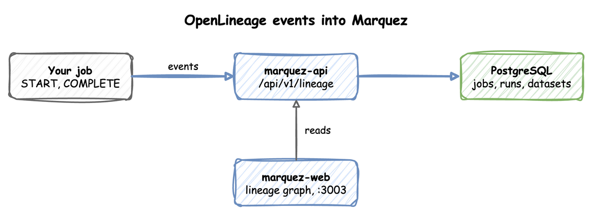
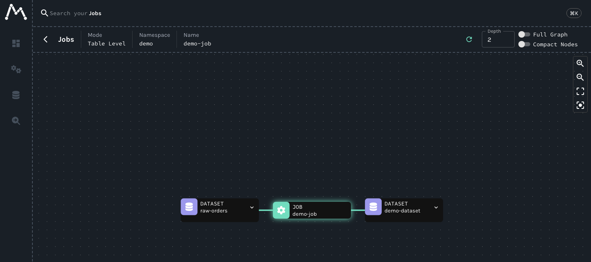

# OpenLineage and Marquez

The `lineage` profile runs Marquez: an API that receives OpenLineage events and keeps jobs, runs and datasets on PostgreSQL, and a web UI that draws the lineage graph. OpenLineage is an open standard for events that say which job read and wrote which datasets in each run. Anything that sends OpenLineage events over HTTP can report to Marquez. The end-to-end tests run the commands below on every release.

This guide builds on [Getting Started](../getting-started.md).

A job sends its events to `marquez-api`, and `marquez-web` reads the API to draw the graph:



Start the profile:

```bash title="docs/snippets/lineage/commands.sh:up"
odctl up lineage
```

| Endpoint | Address |
| --- | --- |
| Marquez API from the host | `http://127.0.0.1:5002` |
| Marquez API inside the `odctl` network | `http://marquez-api:5000` |
| Lineage graph UI | `http://127.0.0.1:3003` |

## Send OpenLineage Events

A run is reported as a `START` event and a `COMPLETE` event with the same run id. The job reads one dataset and writes another:

```bash title="docs/snippets/lineage/commands.sh:send"
RUN_ID=a1b2c3d4-0000-4000-8000-000000000001
NOW=$(date -u +%Y-%m-%dT%H:%M:%S.000Z)

for event in START COMPLETE; do
  curl -X POST http://127.0.0.1:5002/api/v1/lineage \
    -H 'Content-Type: application/json' \
    -d "{\"eventType\":\"$event\",\"eventTime\":\"$NOW\",
         \"producer\":\"demo\",
         \"run\":{\"runId\":\"$RUN_ID\"},
         \"job\":{\"namespace\":\"demo\",\"name\":\"demo-job\"},
         \"inputs\":[{\"namespace\":\"demo\",\"name\":\"raw-orders\"}],
         \"outputs\":[{\"namespace\":\"demo\",\"name\":\"demo-dataset\"}]}"
done
```

The run id is a UUID, as OpenLineage requires. Each request prints nothing when Marquez accepts the event.

## Read the Lineage Back

These read the namespaces, the job and the output dataset back from the API:

```bash title="docs/snippets/lineage/commands.sh:read"
curl http://127.0.0.1:5002/api/v1/namespaces
curl http://127.0.0.1:5002/api/v1/namespaces/demo/jobs/demo-job
curl http://127.0.0.1:5002/api/v1/namespaces/demo/datasets/demo-dataset
```

Marquez writes the job, the run and the dataset from the events, so all three read back. The first command lists the namespaces, which include `demo`. The second returns the job `demo-job` as JSON, with `raw-orders` among its inputs, `demo-dataset` among its outputs and a `latestRun` in state `COMPLETED`. The third returns the dataset. The UI shows them under the `demo` namespace.

The UI draws the job between the datasets it read and wrote:

{ .screenshot }

## From Another Container

Inside the [`odctl` network](../how-it-works.md#how-you-reach-a-service), send events to `http://marquez-api:5000/api/v1/lineage`. For an OpenLineage client's HTTP transport, set the URL to `http://marquez-api:5000`, because the transport adds `api/v1/lineage` by default.

## Runnable Example

Save this file as `example.sh` and run it with `bash example.sh` in the folder that holds your `.odctl` workspace. It gives each run a new id, so it reports a new run every time:

```bash title="docs/snippets/lineage/example.sh"
#!/usr/bin/env bash
# Starts lineage, reports one run of a job that reads raw-orders and writes
# demo-dataset, and prints the state of the job's latest run.
set -euo pipefail

odctl up lineage

RUN_ID=$(python3 -c 'import uuid; print(uuid.uuid4())')
NOW=$(date -u +%Y-%m-%dT%H:%M:%S.000Z)
for event in START COMPLETE; do
  curl -s -X POST http://127.0.0.1:5002/api/v1/lineage \
    -H 'Content-Type: application/json' \
    -d "{\"eventType\":\"$event\",\"eventTime\":\"$NOW\",
         \"producer\":\"demo\",
         \"run\":{\"runId\":\"$RUN_ID\"},
         \"job\":{\"namespace\":\"demo\",\"name\":\"demo-job\"},
         \"inputs\":[{\"namespace\":\"demo\",\"name\":\"raw-orders\"}],
         \"outputs\":[{\"namespace\":\"demo\",\"name\":\"demo-dataset\"}]}"
done

curl -s http://127.0.0.1:5002/api/v1/namespaces/demo/jobs/demo-job \
  | python3 -c 'import json, sys; run = json.load(sys.stdin)["latestRun"]; print(run["id"], run["state"])'
```

It prints the new run's id and `COMPLETED`.
