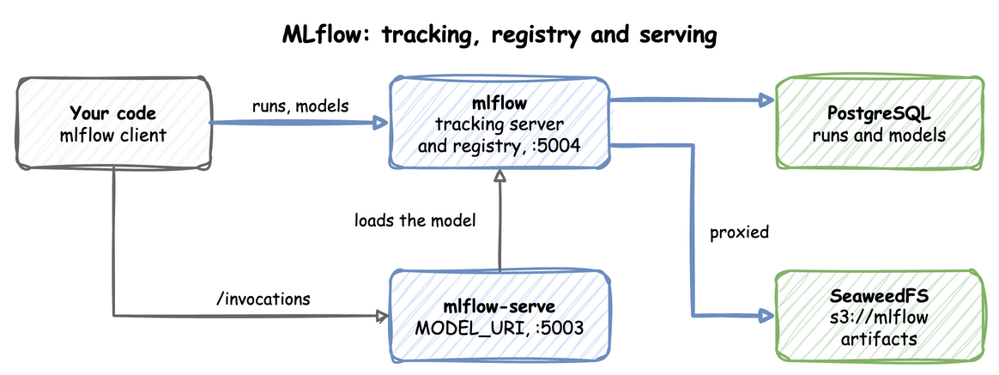
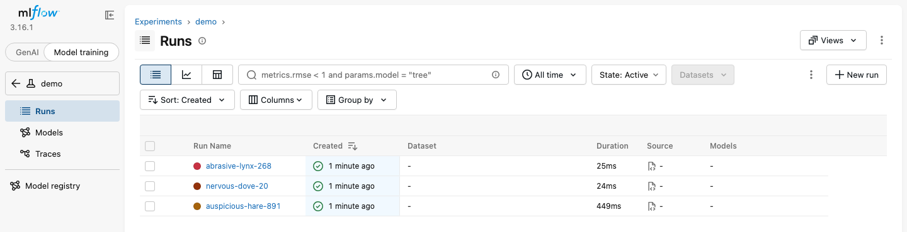
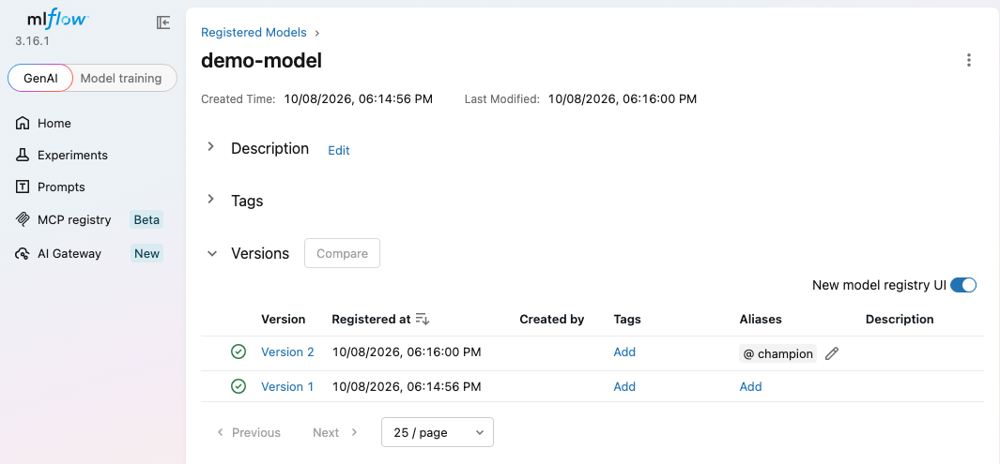

# MLflow Tracking and Model Serving

The `mlflow` profile runs two containers. `mlflow` is the tracking server and model registry, with runs on PostgreSQL and artifacts on SeaweedFS under `s3://mlflow`. `mlflow-serve` scores a registered model over HTTP. The end-to-end tests run the commands below on every release.

This guide builds on [Getting Started](../getting-started.md). Its last section reads features from [Feast with Iceberg](feast-iceberg.md#push-features-from-flink-sql).

Your code logs runs and models to the tracking server, and `mlflow-serve` loads a registered model from it:



Start the profile:

```bash title="docs/snippets/mlflow/commands.sh:up"
odctl up mlflow
```

| Endpoint | Address |
| --- | --- |
| Tracking UI and API from the host | `http://127.0.0.1:5004` |
| Tracking API inside the `odctl` network | `http://mlflow:5000` |
| Model server from the host | `http://127.0.0.1:5003/invocations` |
| Model server inside the `odctl` network | `http://mlflow-serve:5003/invocations` |

The server runs MLflow 3.16.1, so install the same client version on the host.

## Log a Run with an Artifact

This logs a run with a parameter, a metric and a small file as an artifact, then prints where the artifacts are stored and the run's artifact list:

```python title="docs/snippets/mlflow/steps.py:log-run"
import pathlib
import mlflow

mlflow.set_tracking_uri("http://127.0.0.1:5004")
mlflow.set_experiment("demo")

p = pathlib.Path("notes.txt")
p.write_text("hello")
with mlflow.start_run() as run:
    mlflow.log_param("k", "v")
    mlflow.log_metric("m", 1.0)
    mlflow.log_artifact(str(p))

print(mlflow.get_run(run.info.run_id).info.artifact_uri)
print([f.path for f in mlflow.MlflowClient().list_artifacts(run.info.run_id)])
```

The code prints the artifact URI and the list `['notes.txt']`. The artifact URI starts with `mlflow-artifacts:/`. The server proxies artifacts, so the client uploads through the tracking server and needs no S3 address or keys. Downloads from your machine need one setting, as [Load a Model from Your Machine](#load-a-model-from-your-machine) shows. The run and its artifact appear in the UI.

The runs are listed under the experiment in the Model training view:

{ .screenshot }

## Register a Model

This trains a small XGBoost classifier, registers it as `demo-model` and points the alias `champion` at the latest version:

```python title="docs/snippets/mlflow/steps.py:register-model"
import mlflow, numpy as np, xgboost as xgb
from mlflow import MlflowClient

mlflow.set_tracking_uri("http://127.0.0.1:5004")
mlflow.set_experiment("demo-model")

X, y = np.array([[0.0], [1.0], [2.0], [3.0]]), np.array([0, 0, 1, 1])
with mlflow.start_run():
    model = xgb.XGBClassifier(n_estimators=5, max_depth=2).fit(X, y)
    mlflow.xgboost.log_model(model, name="model", registered_model_name="demo-model")

client = MlflowClient()
version = max(int(mv.version) for mv in client.search_model_versions("name='demo-model'"))
client.set_registered_model_alias("demo-model", "champion", version)
```

The run prints `Created version '1' of model 'demo-model'`. This needs XGBoost on the host. The model server has XGBoost 3.2, so install the same minor version to log a model it can load.

The registry lists each version, with the `champion` alias on the latest:

{ .screenshot }

## Serve the Model

`mlflow-serve` starts with the profile and waits idle while `MODEL_URI` is empty. `MODEL_URI` is set in `.odctl/.env`, which `odctl init` writes. Change its line there to:

```bash title="docs/snippets/mlflow/model-uri.env"
MODEL_URI="models:/demo-model@champion"
```

Then replace the containers with `odctl recreate mlflow`, so `mlflow-serve` starts with the new value, and score two rows:

```bash title="docs/snippets/mlflow/commands.sh:serve"
odctl recreate mlflow
curl -X POST http://127.0.0.1:5003/invocations \
  -H 'Content-Type: application/json' -d '{"inputs": [[0.0], [3.0]]}'
```

The response is `{"predictions": [0, 0]}`, one prediction per input row. Check the body rather than the status code, because the server answers 200 with an error payload when scoring fails. `http://127.0.0.1:5003/ping` answers once the model is loaded.

## Move the Alias to a New Version

`mlflow-serve` resolves `MODEL_URI` once, when its container starts. A new version registered behind an unchanged alias such as `champion` is not served until you run `odctl restart mlflow`. Nothing reports an error in the meantime, and the predictions stay those of the old version. To see the change in `.env`, use a version URI such as `models:/demo-model/2` and run `odctl recreate mlflow`.

Run the code from [Register a Model](#register-a-model) again with `min_child_weight=0` added to `XGBClassifier`. The trees then split, so the new version predicts differently. It registers version 2 and moves `champion` to it. Then restart the containers and score again:

```bash title="docs/snippets/mlflow/commands.sh:new-version"
odctl restart mlflow
# The server answers nothing while the model loads: 16 seconds in one run.
until curl -fs http://127.0.0.1:5003/ping >/dev/null; do sleep 2; done
curl -X POST http://127.0.0.1:5003/invocations \
  -H 'Content-Type: application/json' -d '{"inputs": [[0.0], [3.0]]}'
```

The predictions now come from version 2: `{"predictions": [0, 1]}` instead of `[0, 0]`.

## Load a Model from Your Machine

Uploads go through the tracking server, but a download does not by default. The server then hands the client presigned URLs for `http://seaweed:8333`, a name only containers in the `odctl` network resolve, so `mlflow.artifacts.download_artifacts` and a `load_model` call such as `mlflow.sklearn.load_model` on your machine wait and print no error. Set `MLFLOW_ENABLE_PROXY_MULTIPART_DOWNLOAD` to `false` before the call, and the client downloads through the tracking server instead:

```python title="docs/snippets/mlflow/steps.py:download"
import os

os.environ["MLFLOW_ENABLE_PROXY_MULTIPART_DOWNLOAD"] = "false"
import mlflow

mlflow.set_tracking_uri("http://127.0.0.1:5004")
path = mlflow.artifacts.download_artifacts("models:/demo-model@champion")
print(sorted(os.listdir(path)))
```

The output is a listing of the model files that includes `MLmodel`. `mlflow-serve` is not affected, because it loads its model inside the `odctl` network.

## Serve a Model That Reads Online Features

The MLflow image has no Feast client. A model can still read online features from `feast-serve` over HTTP, with an `mlflow.pyfunc.PythonModel` whose `predict` method sends the request. This one reads `conv_rate` of the `driver_pushed` feature view from [Push Features from Flink SQL](feast-iceberg.md#push-features-from-flink-sql) and scores a driver 1 when it is above 0.5. Run that section first, so the online store holds `conv_rate` 0.9 for driver 1001, then save the model class as `driver_score.py`:

```python title="docs/snippets/mlflow/driver_score.py"
import mlflow
import requests


class DriverScore(mlflow.pyfunc.PythonModel):
    """Scores a driver 1 when the online store holds a conversion rate above 0.5."""

    def predict(self, context, model_input, params=None):
        reply = requests.post(
            "http://feast-serve:6566/get-online-features",
            json={
                "features": ["driver_pushed:conv_rate"],
                "entities": {"driver_id": [int(i) for i in model_input["driver_id"]]},
            },
            timeout=10,
        ).json()
        names = reply["metadata"]["feature_names"]
        rates = reply["results"][names.index("conv_rate")]["values"]
        return [int(rate is not None and rate > 0.5) for rate in rates]


mlflow.models.set_model(DriverScore())
```

Then register it from a file, so that the server loads the class from the code and not from a copy pickled on your machine. Run this in the folder that holds `driver_score.py`. It gives the model a signature and no input example, because an example would make MLflow call `predict` on your machine, where `feast-serve` does not resolve:

```python title="docs/snippets/mlflow/steps.py:features-model"
import mlflow, pandas as pd
from mlflow import MlflowClient
from mlflow.models import infer_signature

mlflow.set_tracking_uri("http://127.0.0.1:5004")
mlflow.set_experiment("driver-score")
with mlflow.start_run():
    mlflow.pyfunc.log_model(
        name="model",
        python_model="driver_score.py",
        pip_requirements=["requests"],
        signature=infer_signature(pd.DataFrame({"driver_id": [1001]}), [1]),
        registered_model_name="driver-score",
    )

client = MlflowClient()
version = max(int(mv.version) for mv in client.search_model_versions("name='driver-score'"))
client.set_registered_model_alias("driver-score", "champion", version)
```

The run prints three warnings, about integer columns, type hints on `predict` and the missing input example, and then `Created version '1' of model 'driver-score'`; the warnings do not stop the registration.

Serve it as in [Serve the Model](#serve-the-model), with this line in `.odctl/.env`:

```bash title="docs/snippets/mlflow/model-uri-features.env"
MODEL_URI="models:/driver-score@champion"
```

Run `odctl recreate mlflow`, then score the driver:

```bash title="docs/snippets/mlflow/commands.sh:features-score"
curl -X POST http://127.0.0.1:5003/invocations \
  -H 'Content-Type: application/json' \
  -d '{"dataframe_split": {"columns": ["driver_id"], "data": [[1001]]}}'
```

The reply is `{"predictions": [1]}`. Right after `apply`, `feast-serve` may not know the feature view yet (see [Push Features from Flink SQL](feast-iceberg.md#push-features-from-flink-sql)), and the reply is an error; run the command again after a minute. The model costs one HTTP request to `feast-serve` for each prediction request, and `mlflow-serve` keeps its 1,500 MB memory limit, which a model with large libraries can reach. The limit is set today by `mem_limit` in the `mlflow-serve` service of `.odctl/compose-mlops.yml`, where an edit can change it.

## From Another Container

Inside the [`odctl` network](../how-it-works.md#how-you-reach-a-service), set the tracking URI to `http://mlflow:5000` and score at `http://mlflow-serve:5003/invocations`. Airflow tasks use these addresses too. Extra Python packages for both MLflow containers go in `_MLOPS_PIP_DEPS` in `.odctl/.env`, followed by `odctl recreate mlflow`. [How It Works](../how-it-works.md#examples) says when those packages are installed again.

## Runnable Example

Save this file as `example.sh` and run it with `bash example.sh` in the folder that holds your `.odctl` workspace, in an environment with `mlflow==3.16.1` and XGBoost 3.2 installed. It logs a run, registers `demo-model`, sets `MODEL_URI` in `.odctl/.env` and scores two rows:

```bash title="docs/snippets/mlflow/example.sh"
#!/usr/bin/env bash
# Starts mlflow, logs a run with an artifact, registers an XGBoost model with
# the alias champion, serves it with mlflow-serve and scores two rows. Run it
# in the folder that holds your .odctl workspace, in an environment with
# mlflow==3.16.1 and xgboost 3.2 installed.
set -euo pipefail

odctl up mlflow

python - <<'PY'
import pathlib
import mlflow, numpy as np, xgboost as xgb
from mlflow import MlflowClient

mlflow.set_tracking_uri("http://127.0.0.1:5004")

mlflow.set_experiment("demo")
p = pathlib.Path("notes.txt")
p.write_text("hello")
with mlflow.start_run() as run:
    mlflow.log_param("k", "v")
    mlflow.log_metric("m", 1.0)
    mlflow.log_artifact(str(p))
print(mlflow.get_run(run.info.run_id).info.artifact_uri)

mlflow.set_experiment("demo-model")
X, y = np.array([[0.0], [1.0], [2.0], [3.0]]), np.array([0, 0, 1, 1])
with mlflow.start_run():
    model = xgb.XGBClassifier(n_estimators=5, max_depth=2).fit(X, y)
    mlflow.xgboost.log_model(model, name="model", registered_model_name="demo-model")
client = MlflowClient()
version = max(int(mv.version) for mv in client.search_model_versions("name='demo-model'"))
client.set_registered_model_alias("demo-model", "champion", version)
PY

# Serve the champion: set MODEL_URI in the workspace and replace the containers.
sed -i.bak 's|^MODEL_URI=.*|MODEL_URI="models:/demo-model@champion"|' .odctl/.env
odctl recreate mlflow
curl -s -X POST http://127.0.0.1:5003/invocations \
  -H 'Content-Type: application/json' -d '{"inputs": [[0.0], [3.0]]}'
echo
```

It prints the artifact URI, `Created version` with the new version number, the recreate messages and `{"predictions": [0, 0]}`. The `sed` command keeps the old `.env` as `.odctl/.env.bak`.
