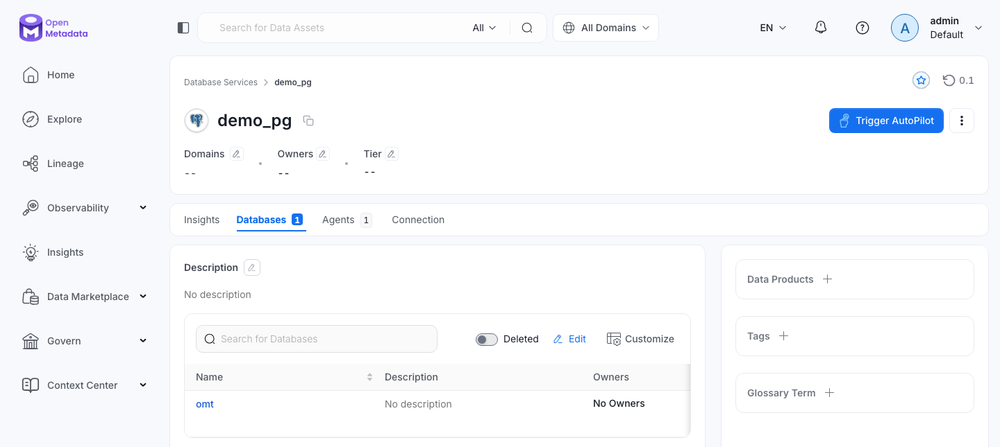

# Catalogue a Database with OpenMetadata

A data catalogue lists the databases, tables and columns of an organisation, so people can search them and see who owns each one. The `metadata` profile runs OpenMetadata, a data catalogue: the server with its UI and REST API, Elasticsearch for search, and an ingestion container, an Airflow that runs the ingestion pipelines the server deploys. Its own tables are in the `omt` database on PostgreSQL. The end-to-end tests run the commands below on every release.

This guide builds on [Getting Started](../getting-started.md). It uses the PostgreSQL that the profile starts as the database to catalogue.

Start the profile:

```bash title="docs/snippets/openmetadata/commands.sh:up"
odctl up metadata
```

| Endpoint | Address |
| --- | --- |
| UI and REST API from the host | `http://127.0.0.1:8585` |
| UI and REST API inside the `odctl` network | `http://openmetadata-server:8585` |
| Ingestion Airflow from the host | `http://127.0.0.1:8087` |

Log in as `admin@open-data.local` with the password `admin`. The domain is `open-data.local`, not the upstream default, and a wrong domain fails with an invalid password error.

## Get a Token

The login API takes the password base64-encoded and returns a JWT, a signed token that later requests send in the `Authorization` header. This sets `TOKEN` and `AUTH` for the next steps, and prints nothing:

```bash title="docs/snippets/openmetadata/commands.sh:login"
TOKEN=$(curl -s -H 'Content-Type: application/json' \
  -d "{\"email\":\"admin@open-data.local\",\"password\":\"$(printf admin | base64)\"}" \
  http://127.0.0.1:8585/api/v1/users/login \
  | python3 -c 'import json,sys; print(json.load(sys.stdin)["accessToken"])')
AUTH="Authorization: Bearer $TOKEN"
```

## Register PostgreSQL as a Database Service

PostgreSQL is already running, so it serves as the source. The server reaches it by its container name. This sets `SVC` to the id of the new service:

```bash title="docs/snippets/openmetadata/commands.sh:service"
SVC=$(curl -s -X PUT -H "$AUTH" -H 'Content-Type: application/json' \
  -d '{"name":"demo_pg","serviceType":"Postgres","connection":{"config":{"type":"Postgres","scheme":"postgresql+psycopg2","username":"user","authType":{"password":"password"},"hostPort":"postgres:5432","database":"omt"}}}' \
  http://127.0.0.1:8585/api/v1/services/databaseServices \
  | python3 -c 'import json,sys; print(json.load(sys.stdin)["id"])')
```

## Run a Metadata Ingestion

Create a pipeline, deploy it as a DAG into the ingestion Airflow, and trigger it:

```bash title="docs/snippets/openmetadata/commands.sh:pipeline"
PIPE=$(curl -s -X POST -H "$AUTH" -H 'Content-Type: application/json' \
  -d "{\"name\":\"demo_pg_metadata\",\"pipelineType\":\"metadata\",\"service\":{\"id\":\"$SVC\",\"type\":\"databaseService\"},\"sourceConfig\":{\"config\":{\"type\":\"DatabaseMetadata\"}},\"airflowConfig\":{\"startDate\":\"2026-01-01T00:00:00.000Z\"}}" \
  http://127.0.0.1:8585/api/v1/services/ingestionPipelines \
  | python3 -c 'import json,sys; print(json.load(sys.stdin)["id"])')

curl -s -X POST -H "$AUTH" http://127.0.0.1:8585/api/v1/services/ingestionPipelines/deploy/$PIPE
curl -s -X POST -H "$AUTH" http://127.0.0.1:8585/api/v1/services/ingestionPipelines/trigger/$PIPE
```

The deploy answers that the pipeline has been created. It works once the ingestion Airflow answers at `http://127.0.0.1:8087/api/v2/monitor/health`, which can be some time after `odctl up metadata` returns. Airflow has to parse the new DAG file before the trigger works, so repeat the trigger every few seconds until it answers that the pipeline has been triggered. Then read the run's state:

```bash title="docs/snippets/openmetadata/commands.sh:status"
curl -s -H "$AUTH" \
  "http://127.0.0.1:8585/api/v1/services/ingestionPipelines/name/demo_pg.demo_pg_metadata?fields=pipelineStatuses"
```

The reply is the pipeline as JSON. The `pipelineState` of the first entry of `pipelineStatuses` reaches `success` when the tables are catalogued. They then appear in the UI under the `demo_pg` service.

{ .screenshot }

## Search the Catalogue

Rebuild the search index, then query it:

```bash title="docs/snippets/openmetadata/commands.sh:search"
curl -s -X POST -H "$AUTH" http://127.0.0.1:8585/api/v1/apps/trigger/SearchIndexingApplication
curl -s -H "$AUTH" "http://127.0.0.1:8585/api/v1/search/query?q=*&index=table_search_index&size=1"
```

The search reply is JSON, and `hits.total.value` counts the searchable tables. The index fills over a few minutes after the rebuild, and then holds more than 100 tables: OpenMetadata's own tables in the `omt` database.

## From Another Container

Inside the [`odctl` network](../how-it-works.md#how-you-reach-a-service), call the API at `http://openmetadata-server:8585`. The server also answers the Model Context Protocol at `http://127.0.0.1:8585/mcp` with the same token.

## Remove the Example

This deletes the service with its pipeline and the tables it catalogued:

```bash title="docs/snippets/openmetadata/commands.sh:remove"
curl -s -X DELETE -H "$AUTH" \
  "http://127.0.0.1:8585/api/v1/services/databaseServices/name/demo_pg?hardDelete=true&recursive=true"
```

## Runnable Example

Save this file as `example.sh` and run it with `bash example.sh` in the folder that holds your `.odctl` workspace. It runs every step above, waits where a step needs time, and removes the service at the end:

```bash title="docs/snippets/openmetadata/example.sh"
#!/usr/bin/env bash
# Starts metadata, registers PostgreSQL as a database service, runs a metadata
# ingestion of the omt database, counts the searchable tables and removes the
# service again.
set -euo pipefail

odctl up metadata
om=http://127.0.0.1:8585/api/v1
json() { python3 -c "import json, sys; print($1)"; }

TOKEN=$(curl -s -H 'Content-Type: application/json' \
  -d "{\"email\":\"admin@open-data.local\",\"password\":\"$(printf admin | base64)\"}" \
  "$om/users/login" | json 'json.load(sys.stdin)["accessToken"]')
AUTH="Authorization: Bearer $TOKEN"

SVC=$(curl -s -X PUT -H "$AUTH" -H 'Content-Type: application/json' \
  -d '{"name":"demo_pg","serviceType":"Postgres","connection":{"config":{"type":"Postgres","scheme":"postgresql+psycopg2","username":"user","authType":{"password":"password"},"hostPort":"postgres:5432","database":"omt"}}}' \
  "$om/services/databaseServices" | json 'json.load(sys.stdin)["id"]')

PIPE=$(curl -s -X POST -H "$AUTH" -H 'Content-Type: application/json' \
  -d "{\"name\":\"demo_pg_metadata\",\"pipelineType\":\"metadata\",\"service\":{\"id\":\"$SVC\",\"type\":\"databaseService\"},\"sourceConfig\":{\"config\":{\"type\":\"DatabaseMetadata\"}},\"airflowConfig\":{\"startDate\":\"2026-01-01T00:00:00.000Z\"}}" \
  "$om/services/ingestionPipelines" | json 'json.load(sys.stdin)["id"]')
# The server deploys the pipeline into the ingestion Airflow, which answers a
# little after the server.
until curl -fs http://127.0.0.1:8087/api/v2/monitor/health >/dev/null; do sleep 5; done
until curl -s -X POST -H "$AUTH" "$om/services/ingestionPipelines/deploy/$PIPE" \
  | grep 'has been created' >/dev/null; do sleep 5; done

# Airflow parses the new DAG file before the trigger works.
until curl -s -X POST -H "$AUTH" "$om/services/ingestionPipelines/trigger/$PIPE" \
  | grep 'has been triggered' >/dev/null; do sleep 5; done

state=""
until [ "$state" = success ] || [ "$state" = failed ]; do
  sleep 10
  state=$(curl -s -H "$AUTH" \
    "$om/services/ingestionPipelines/name/demo_pg.demo_pg_metadata?fields=pipelineStatuses" \
    | json '(json.load(sys.stdin).get("pipelineStatuses") or [{}])[0].get("pipelineState", "")')
done
echo "ingestion: $state"

# The search index fills over a few minutes after it is rebuilt.
curl -s -X POST -H "$AUTH" "$om/apps/trigger/SearchIndexingApplication" >/dev/null
hits=0
until [ "$hits" -gt 100 ]; do
  sleep 5
  hits=$(curl -s -H "$AUTH" "$om/search/query?q=*&index=table_search_index&size=1" \
    | json 'json.load(sys.stdin)["hits"]["total"]["value"]')
done
echo "searchable tables: $hits"

curl -s -X DELETE -H "$AUTH" \
  "$om/services/databaseServices/name/demo_pg?hardDelete=true&recursive=true" >/dev/null
echo "removed demo_pg"
```

It prints `ingestion: success`, the number of searchable tables, which is more than 100, and `removed demo_pg`. The whole run takes several minutes.
