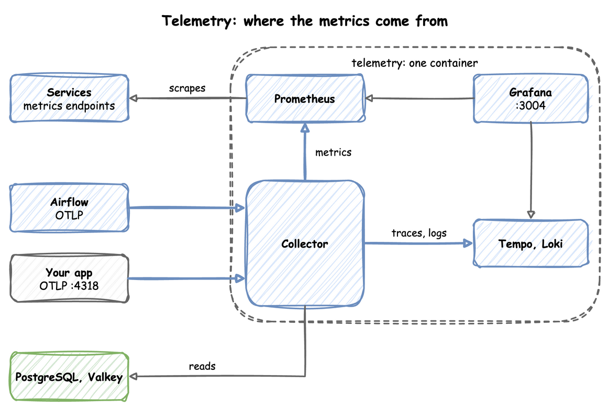
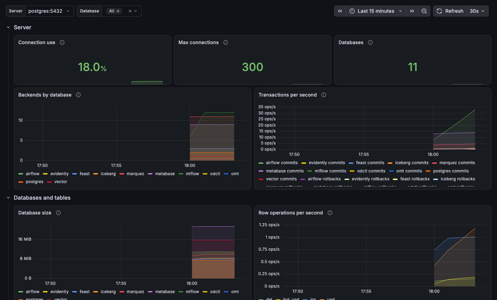

# Telemetry

The `telemetry` profile runs the grafana/otel-lgtm image: an OpenTelemetry Collector, Prometheus, Tempo, Loki and Grafana in one container. OpenTelemetry is an open standard for metrics, traces and logs, and OTLP is its protocol for sending them. Tempo stores traces, Loki stores logs, and Grafana draws dashboards from all three stores.

This guide builds on [Getting Started](../getting-started.md). Start the profile next to the profiles you want to watch:

```bash title="docs/snippets/telemetry/commands.sh:up"
odctl up telemetry kafka-lite flink-lite
```

Prometheus reads metrics from the services, and the collector receives OTLP and passes each kind of data to its store:



| Endpoint | Address |
| --- | --- |
| Grafana (user `user`, password `password`) | `http://127.0.0.1:3004` |
| Prometheus | `http://127.0.0.1:19090` |
| OTLP through the collector | `127.0.0.1:4317` (gRPC), `http://127.0.0.1:4318` (HTTP) |

## Where the Metrics Come From

Prometheus scrapes the services that publish a metrics endpoint, by container name on the `odctl` network. Airflow pushes its metrics over OTLP to the collector, and the collector reads PostgreSQL and Valkey directly. A service that is not running is a target that is down.

## Dashboards

Grafana has a dashboard per service in a folder named `odctl`. A dashboard fills in once its service's profile is up. The dashboards are JSON files in `.odctl/grafana/dashboards/`. Edit a file and run `odctl restart telemetry` to load it. Changes made in the Grafana UI are not kept.

For example, the PostgreSQL dashboard:

{ .screenshot }

## Send Your Own Metrics

Point an OpenTelemetry SDK at `http://127.0.0.1:4318`, its default HTTP port. The end-to-end tests post one metric with curl, which shows the path:

```bash title="docs/snippets/telemetry/commands.sh:send-metric"
ts=$(python3 -c "import time;print(int(time.time()*1e9))")
cat > /tmp/otlp.json <<JSON
{"resourceMetrics":[{"resource":{"attributes":[{"key":"service.name","value":{"stringValue":"demo"}}]},
"scopeMetrics":[{"scope":{"name":"demo"},"metrics":[{"name":"demo_total","unit":"1",
"sum":{"aggregationTemporality":2,"isMonotonic":true,"dataPoints":[
{"asDouble":42,"timeUnixNano":"${ts}","startTimeUnixNano":"${ts}","attributes":[]}]}}]}]}]}
JSON
curl -X POST -H "Content-Type: application/json" --data-binary @/tmp/otlp.json \
  http://127.0.0.1:4318/v1/metrics
curl "http://127.0.0.1:19090/api/v1/query?query=demo_total"
```

The collector answers `{"partialSuccess":{}}`. The collector passes metrics on in batches, so the query can come back empty for a few seconds. Then its result holds `demo_total` with the value `"42"`. Prometheus also accepts OTLP metrics directly at `http://127.0.0.1:19090/api/v1/otlp/v1/metrics`.

## From Another Container

Inside the [`odctl` network](../how-it-works.md#how-you-reach-a-service), send OTLP to the collector at `otel-lgtm:4317` (gRPC) or `http://otel-lgtm:4318` (HTTP), as Airflow does. Prometheus is `http://otel-lgtm:9090` and Grafana is `http://otel-lgtm:3000`.

## Runnable Example

Save this file as `example.sh` and run it with `bash example.sh` in the folder that holds your `.odctl` workspace. It waits until Prometheus returns the metric:

```bash title="docs/snippets/telemetry/example.sh"
#!/usr/bin/env bash
# Starts telemetry, sends one OTLP metric to the collector and waits until
# Prometheus returns it.
set -euo pipefail

odctl up telemetry

ts=$(python3 -c "import time;print(int(time.time()*1e9))")
curl -s -X POST -H "Content-Type: application/json" http://127.0.0.1:4318/v1/metrics -d @- <<JSON
{"resourceMetrics":[{"resource":{"attributes":[{"key":"service.name","value":{"stringValue":"demo"}}]},
"scopeMetrics":[{"scope":{"name":"demo"},"metrics":[{"name":"demo_total","unit":"1",
"sum":{"aggregationTemporality":2,"isMonotonic":true,"dataPoints":[
{"asDouble":42,"timeUnixNano":"${ts}","startTimeUnixNano":"${ts}","attributes":[]}]}}]}]}]}
JSON
echo

# The collector passes metrics on in batches, so the first queries can be empty.
until curl -s "http://127.0.0.1:19090/api/v1/query?query=demo_total" | grep '"42"' >/dev/null; do
  sleep 2
done
curl -s "http://127.0.0.1:19090/api/v1/query?query=demo_total"
echo
```

It prints the collector's answer and then the query result, with `demo_total` and the value `"42"`.
