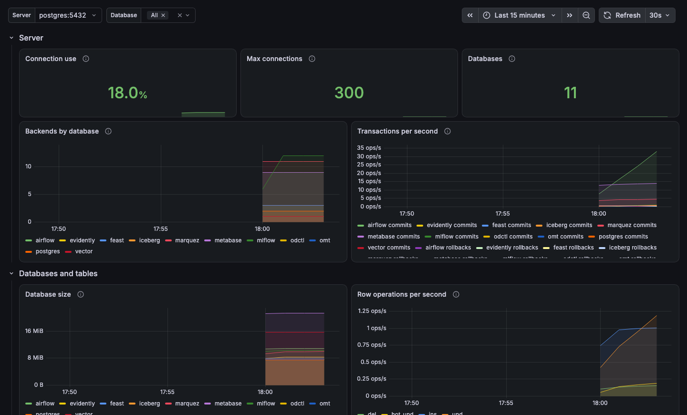
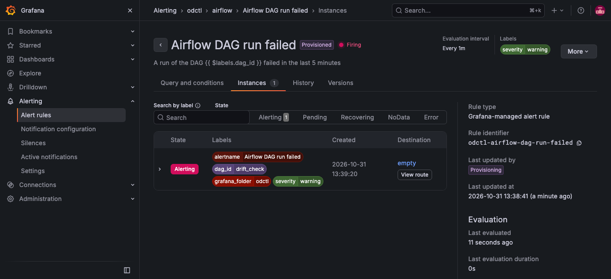

# Telemetry

The `telemetry` profile runs the grafana/otel-lgtm image: an OpenTelemetry Collector, Prometheus, Tempo, Loki and Grafana in one container. OpenTelemetry is an open standard for metrics, traces and logs, and OTLP is its protocol for sending them. Tempo stores traces, Loki stores logs, and Grafana draws dashboards from all three stores.

This guide builds on [Getting Started](../getting-started.md). Start the profile next to the profiles you want to watch:

```bash title="docs/snippets/telemetry/commands.sh:up"
odctl up telemetry kafka-lite flink-lite
```

Prometheus reads metrics from the services, the collector receives OTLP and passes each kind of data to its store, and Grafana reads the stores and evaluates its alert rule against Prometheus:


| Endpoint | Address |
| --- | --- |
| Grafana (user `user`, password `password`) | `http://127.0.0.1:3004` |
| Prometheus | `http://127.0.0.1:19090` |
| OTLP through the collector | `127.0.0.1:4317` (gRPC), `http://127.0.0.1:4318` (HTTP) |

## Where the Metrics Come From

Prometheus scrapes the services that publish a metrics endpoint, by container name on the `odctl` network. Airflow pushes its metrics over OTLP to the collector, and the collector reads PostgreSQL and Valkey directly. A service that is not running is a target that is down.

## Dashboards

Grafana has a dashboard per service in a folder named `odctl`. A dashboard fills in once its service's profile is up. The dashboards are JSON files in `.odctl/grafana/dashboards/`. Edit a file and run `odctl restart telemetry` to load it. Changes made in the Grafana UI are not kept.

For example, the PostgreSQL dashboard:

{ .screenshot }

## Send Your Own Metrics

Point an OpenTelemetry SDK at `http://127.0.0.1:4318`, its default HTTP port. The end-to-end tests post one metric with curl, which shows the path:

```bash title="docs/snippets/telemetry/commands.sh:send-metric"
ts=$(python3 -c "import time;print(int(time.time()*1e9))")
cat > /tmp/otlp.json <<JSON
{"resourceMetrics":[{"resource":{"attributes":[{"key":"service.name","value":{"stringValue":"demo"}}]},
"scopeMetrics":[{"scope":{"name":"demo"},"metrics":[{"name":"demo_total","unit":"1",
"sum":{"aggregationTemporality":2,"isMonotonic":true,"dataPoints":[
{"asDouble":42,"timeUnixNano":"${ts}","startTimeUnixNano":"${ts}","attributes":[]}]}}]}]}]}
JSON
curl -X POST -H "Content-Type: application/json" --data-binary @/tmp/otlp.json \
  http://127.0.0.1:4318/v1/metrics
curl "http://127.0.0.1:19090/api/v1/query?query=demo_total"
```

The collector answers `{"partialSuccess":{}}`. The collector passes metrics on in batches, so the query can come back empty for a few seconds. Then its result holds `demo_total` with the value `"42"`. Prometheus also accepts OTLP metrics directly at `http://127.0.0.1:19090/api/v1/otlp/v1/metrics`.

## Add an Alert Rule

An alert rule is a query that Grafana runs against Prometheus every minute, and a limit it compares the result with. The rule fires when the result passes the limit. Grafana then shows one alert for each DAG, or other label set, that the query returns. odctl ships one rule, which fires when an Airflow DAG run fails. This section builds on [Airflow DAGs from S3](airflow-dags.md), which explains how to upload and run a DAG, and on [Evidently Reports](evidently-reports.md), which explains drift.

The shipped rule is [`airflow.yaml`](https://github.com/jaehyeon-kim/odctl/blob/main/src/odctl/resources/grafana/alerting/airflow.yaml) in `.odctl/grafana/alerting/`. Grafana loads every file in that folder when it starts, so restart `telemetry` after you add or edit a file. Grafana marks these rules Provisioned and does not let you edit them in its UI. This lists the rules that Grafana loaded:

```bash title="docs/snippets/telemetry/commands.sh:alert-rules"
# Title of each alert rule that Grafana loaded.
curl -s -u user:password http://127.0.0.1:3004/api/v1/provisioning/alert-rules \
  | python3 -c '
import json, sys
for rule in json.load(sys.stdin):
    print(rule["title"])'
```

```text
Airflow DAG run failed
```

The rule counts the DAG runs that failed in the last 5 minutes for each DAG, from the metric `airflow_dagrun_duration_failed_milliseconds` that Airflow sends, and fires for each DAG with at least one. These 5 minutes are the rule's window. The window, the evaluation every minute and the labels are set in the file and can change. The rule has no waiting period, so it fires on the first evaluation that sees a failure.

When `telemetry` starts while Airflow is already running, Prometheus has no earlier sample of each series, so the rule also fires, for one window, for each DAG that has failed since Airflow started. A restart keeps Prometheus's samples, so it does not do this.

To see it fire, run a DAG that fails. This DAG checks for [data drift](evidently-reports.md): it compares a column of current data with a reference dataset and fails when the column has drifted.

It measures the change with Evidently's `ValueDrift` metric and the method `wasserstein`, the distance between the two distributions in units of the reference's standard deviation. The DAG fails when the distance is above `DRIFT_THRESHOLD`. The DAG names its method and its threshold because Evidently picks a different test by default for a reference of 1,000 rows or fewer, and a different test gives a score on a different scale.

The parameter `shift` moves the mean of the current data away from the reference's, in standard deviations, so the default run drifts and a run with `shift` 0 does not. Save it as `drift_check.py`:

```python title="docs/snippets/telemetry/drift_check.py" hl_lines="10 35 39 40"
import numpy as np
import pandas as pd
import pendulum
from airflow.sdk import DAG, Param, task
from evidently import Report
from evidently.metrics import ValueDrift

# The Wasserstein distance is in units of the reference column's standard
# deviation. A run fails when the distance passes this value.
DRIFT_THRESHOLD = 0.5

with DAG(
    dag_id="drift_check",
    start_date=pendulum.datetime(2026, 1, 1, tz="UTC"),
    schedule=None,
    catchup=False,
    # How far the current data's mean has moved from the reference's, in standard deviations.
    params={"shift": Param(3.0, type="number")},
):

    @task
    def check_drift(params=None):
        """Fail the run when column x of the current data has drifted from the reference.

        Args:
            params: The run's parameters. `shift` moves the current data's mean.

        Raises:
            ValueError: When the Wasserstein distance is above DRIFT_THRESHOLD.
        """
        reference = pd.DataFrame({"x": np.random.default_rng(7).normal(0, 1, 500)})
        current = pd.DataFrame(
            {"x": np.random.default_rng(8).normal(params["shift"], 1, 500)}
        )
        report = Report([ValueDrift(column="x", method="wasserstein")])
        result = report.run(current_data=current, reference_data=reference)
        distance = result.dict()["metrics"][0]["value"]
        print(f"Wasserstein distance of x: {distance:.2f}, threshold {DRIFT_THRESHOLD}")
        if distance > DRIFT_THRESHOLD:
            raise ValueError(f"x drifted: {distance:.2f} is above {DRIFT_THRESHOLD}")

    check_drift()
```

The DAG needs Evidently in the Airflow container. odctl installs the packages in `_AIRFLOW_PIP_DEPS` when Airflow starts, as [Evidently Reports](evidently-reports.md#from-another-container) explains, so set the key and start Airflow. Run this in the folder that holds your `.odctl` workspace:

```bash title="docs/snippets/telemetry/commands.sh:drift-env"
sed -i.bak 's|^_AIRFLOW_PIP_DEPS=.*|_AIRFLOW_PIP_DEPS="evidently==0.7.23"|' .odctl/.env
```

The command prints nothing and leaves the old file as `.odctl/.env.bak`.

```bash title="docs/snippets/telemetry/commands.sh:drift-up"
odctl up airflow
```

The command prints each container it starts and ends with `All requested profiles successfully started!`. If Airflow is already running, run `odctl recreate airflow` instead, because a restart does not read `.env` again, as [Apply a Change](../how-it-works.md#apply-a-change) explains. Copy the DAG into the Airflow container and upload it to `s3://airflow/dags`, as [Airflow DAGs from S3](airflow-dags.md#upload-a-dag) does:

```bash title="docs/snippets/telemetry/commands.sh:drift-upload"
docker cp drift_check.py airflow:/tmp/drift_check.py
docker exec airflow python -c '
import boto3
boto3.client("s3", endpoint_url="http://seaweed:8333").upload_file(
    "/tmp/drift_check.py", "airflow", "dags/drift_check.py")'
```

The upload prints nothing. Airflow reads the bucket every 15 seconds, so wait until the first command lists the DAG. Then unpause it and trigger a run named `drifted`:

```bash title="docs/snippets/telemetry/commands.sh:drift-run"
docker exec airflow airflow dags list | grep drift_check
docker exec airflow airflow dags unpause drift_check
docker exec airflow airflow dags trigger drift_check --run-id drifted
```

The last command prints the new run in state `queued`. The task fails after a few seconds, so list the runs with `docker exec airflow airflow dags list-runs drift_check` until `drifted` has the state `failed`. Airflow sends its metrics to the collector every 15 seconds, set by `OTEL_METRIC_EXPORT_INTERVAL` in `.odctl/compose-orch.yml`. Grafana evaluates the rule every minute, so the alert appears within about 2 minutes. This lists the alerts that are firing:

```bash title="docs/snippets/telemetry/commands.sh:alert-state"
# Alerts that are firing, with the DAG each names.
curl -s -u user:password http://127.0.0.1:3004/api/prometheus/grafana/api/v1/alerts \
  | python3 -c '
import json, sys
for alert in json.load(sys.stdin)["data"]["alerts"]:
    if alert["state"] == "Alerting":
        print(alert["labels"]["alertname"], alert["labels"].get("dag_id", ""), alert["state"])'
```

```text
Airflow DAG run failed drift_check Alerting
```

The alert carries the label `dag_id` with the DAG that failed. Grafana calls the state `Alerting` in its API and Firing in its UI. Open [http://127.0.0.1:3004/alerting/grafana/odctl-airflow-dag-run-failed/view?tab=instances](http://127.0.0.1:3004/alerting/grafana/odctl-airflow-dag-run-failed/view?tab=instances) and log in with `user` and `password`:

{ .screenshot }

The destination is `empty`, Grafana's default contact point. It sends nothing, because odctl configures no contact point of its own. A contact point is where Grafana sends a notification, such as an email address or a chat channel. A firing alert therefore shows only in Grafana.

The summary under the rule's title is the template, because one rule covers every DAG. Each alert has it filled in with its DAG, which the instance's details and the alerts API show.

To be told when an alert fires, you need a contact point and a notification policy that routes alerts to it. Grafana's database lives inside the `otel-lgtm` container and has no volume, so `odctl down` deletes a contact point made in the UI. Keep them in a file instead. Grafana loads a contact point and a notification policy from a file in `.odctl/grafana/alerting/` at each start, in the format of [Grafana's file provisioning](https://grafana.com/docs/grafana/latest/alerting/set-up/provision-alerting-resources/file-provisioning/). Add the file and restart `telemetry`, as above.

Deleting a file and restarting leaves its rule, contact point or policy in Grafana. `odctl down telemetry` and then `odctl up telemetry` remove them.

To tell whoever receives the alert what to do, add a `runbook_url` annotation to the rule in its file.

The alert clears when the failed run falls out of the window. A run below the threshold raises none. This triggers a run named `steady` with `shift` 0 and prints the new run in state `queued`. The second command prints the distance of each run from its task log:

```bash title="docs/snippets/telemetry/commands.sh:drift-steady"
docker exec airflow airflow dags trigger drift_check --run-id steady --conf '{"shift": 0}'
```

```bash title="docs/snippets/telemetry/commands.sh:drift-score"
# Distance each run printed, from its task log.
docker exec airflow sh -c 'cd /opt/airflow/logs/dag_id=drift_check && grep -o "Wasserstein distance[^\"]*" run_id=*/task_id=check_drift/attempt=1.log'
```

```text
run_id=drifted/task_id=check_drift/attempt=1.log:Wasserstein distance of x: 3.35, threshold 0.5
run_id=steady/task_id=check_drift/attempt=1.log:Wasserstein distance of x: 0.16, threshold 0.5
```

Both runs draw their samples from fixed seeds, so the distances repeat on every run. The drifted run is above the threshold and fails, and the steady run is below it and succeeds.

A rule of your own is another file in the same folder. Copy it in and restart `telemetry`, as above. To write one, start from the sample below and change its `uid`, `title`, query and limit. This sample fires when the model calls of the last hour have used more tokens than a budget. odctl does not provision it, because the budget is yours: change the highlighted limit.

`gen_ai.client.token.usage` is the OpenTelemetry metric for the tokens that one model call used. Prometheus writes its name with `_` in place of `.`. For a histogram with explicit buckets, as the OpenTelemetry SDKs send by default, Prometheus keeps the sum in the series that ends in `_sum`. The query therefore sums `gen_ai_client_token_usage_sum`. An SDK set to exponential histograms sends one native histogram series with no `_sum`, as Airflow's does, and this query then returns nothing.

The query counts each series in one of two ways:

- A series that began within the last hour counts by its last value, which is all its tokens since it began, even after the application stops sending.
- A series that is more than an hour old counts by its increase over the hour, while the application exports at least every 5 minutes, as the OpenTelemetry SDKs do by default.

`increase()` counts only the change after a series' first sample. Alone, it would miss the tokens in that first sample, and every token of an application that exports once. When `telemetry` starts while the application is already running, the first hour counts all tokens since the application started.

Save it as `token_budget.yaml`:

```yaml title="docs/snippets/telemetry/token_budget.yaml" hl_lines="52"
# A sample alert rule: it fires when the model calls of the last hour have used more
# tokens than the budget set below. Copy it into .odctl/grafana/alerting/ and run
# odctl restart telemetry to load it.
apiVersion: 1

groups:
  - orgId: 1
    name: model-calls
    folder: odctl
    interval: 1m
    rules:
      - uid: odctl-token-budget
        title: Model call tokens over budget
        condition: C
        data:
          # Tokens that gen_ai.client.token.usage recorded in the last hour, input
          # and output together. Prometheus keeps the histogram's sum in the series
          # gen_ai_client_token_usage_sum. A series that began within the last hour
          # counts by its last value, which is all its tokens since it began, also
          # when the application stopped sending more than 5 minutes ago, because
          # increase() counts only the change after a series' first sample. A series
          # more than an hour old counts by its increase over the hour, while the
          # application exports at least every 5 minutes. When `telemetry` starts
          # while the application is already running, the first hour counts all
          # tokens since the application started.
          - refId: A
            relativeTimeRange:
              from: 3600
              to: 0
            datasourceUid: prometheus
            model:
              refId: A
              instant: true
              expr: sum((last_over_time(gen_ai_client_token_usage_sum[1h]) unless gen_ai_client_token_usage_sum offset 1h) or increase(gen_ai_client_token_usage_sum[1h]))
          - refId: B
            datasourceUid: __expr__
            model:
              refId: B
              type: reduce
              expression: A
              reducer: last
          - refId: C
            datasourceUid: __expr__
            model:
              refId: C
              type: threshold
              expression: B
              conditions:
                - evaluator:
                    type: gt
                    # The budget: change this number to your own limit.
                    params: [1000000]
        # No model calls in the last hour is under budget, not an alert.
        noDataState: OK
        execErrState: Error
        for: 0s
        labels:
          severity: warning
        annotations:
          summary: "Model calls used more tokens in the last hour than the budget"
```

```bash title="docs/snippets/telemetry/commands.sh:add-rule"
cp token_budget.yaml .odctl/grafana/alerting/
odctl restart telemetry
```

The copy prints nothing, and the restart ends with `Restart complete.` Grafana and the collector take a few seconds to answer after the restart. Run the listing command from the start of this section again until it prints both rules:

```text
Airflow DAG run failed
Model call tokens over budget
```

The budget rule has no data until an application sends the metric, and no data counts as no alert. [Send Your Own Metrics](#send-your-own-metrics) shows how to send a metric to the collector.

## From Another Container

Inside the [`odctl` network](../how-it-works.md#how-you-reach-a-service), send OTLP to the collector at `otel-lgtm:4317` (gRPC) or `http://otel-lgtm:4318` (HTTP), as Airflow does. Prometheus is `http://otel-lgtm:9090` and Grafana is `http://otel-lgtm:3000`.

This command sends an empty batch to the collector from a container on the network:

```bash title="docs/snippets/telemetry/commands.sh:container"
# An empty batch is enough to check the address. The collector answers 200.
docker run --rm --network odctl curlimages/curl:8.17.0 -s -o /dev/null -w "%{http_code}\n" \
  -H "Content-Type: application/json" -d '{}' http://otel-lgtm:4318/v1/traces
```

```text
200
```

## Runnable Example

Save this file as `example.sh` and run it with `bash example.sh` in the folder that holds your `.odctl` workspace. It waits until Prometheus returns the metric:

```bash title="docs/snippets/telemetry/example.sh"
#!/usr/bin/env bash
# Starts telemetry, sends one OTLP metric to the collector and waits until
# Prometheus returns it.
set -euo pipefail

odctl up telemetry

ts=$(python3 -c "import time;print(int(time.time()*1e9))")
curl -s -X POST -H "Content-Type: application/json" http://127.0.0.1:4318/v1/metrics -d @- <<JSON
{"resourceMetrics":[{"resource":{"attributes":[{"key":"service.name","value":{"stringValue":"demo"}}]},
"scopeMetrics":[{"scope":{"name":"demo"},"metrics":[{"name":"demo_total","unit":"1",
"sum":{"aggregationTemporality":2,"isMonotonic":true,"dataPoints":[
{"asDouble":42,"timeUnixNano":"${ts}","startTimeUnixNano":"${ts}","attributes":[]}]}}]}]}]}
JSON
echo

# The collector passes metrics on in batches, so the first queries can be empty.
until curl -s "http://127.0.0.1:19090/api/v1/query?query=demo_total" | grep '"42"' >/dev/null; do
  sleep 2
done
curl -s "http://127.0.0.1:19090/api/v1/query?query=demo_total"
echo
```

It prints the collector's answer and then the query result, with `demo_total` and the value `"42"`.
