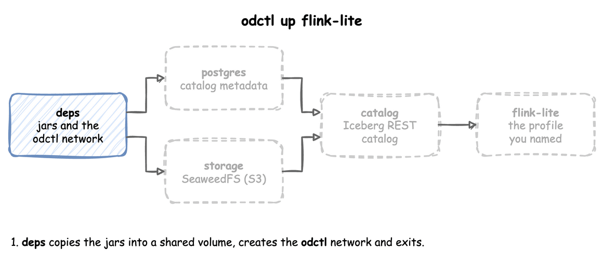
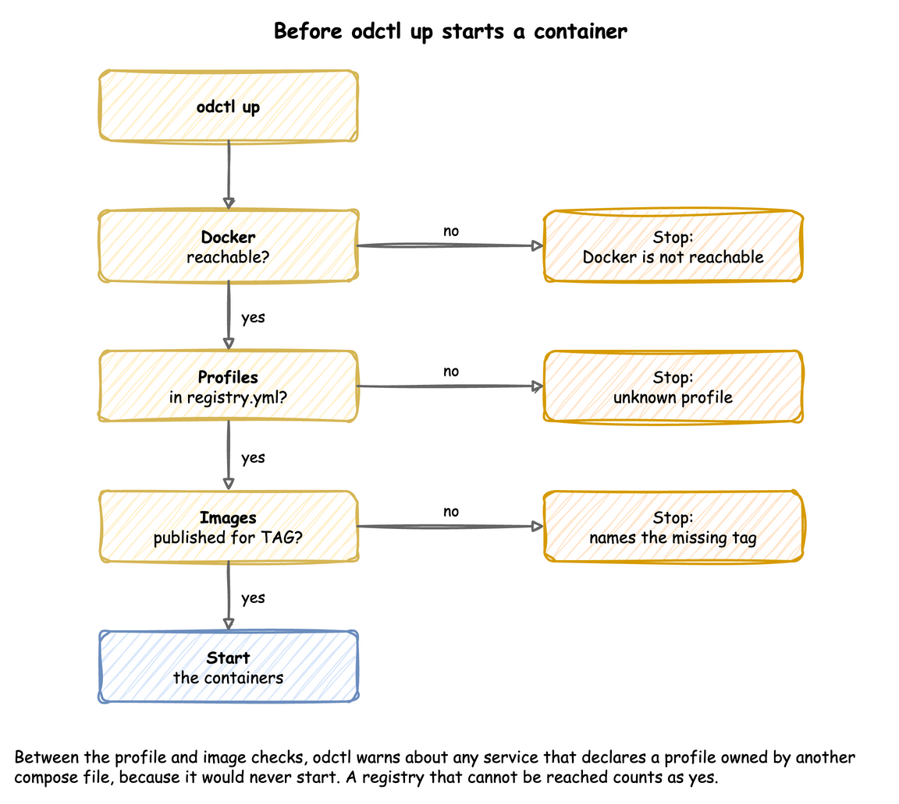

# How It Works

This page explains how odctl chooses, starts and reaches its services, where their data lives and how to change them. It builds on [Getting Started](getting-started.md).

## Profiles

A profile is a named group of services that start together, such as `kafka-lite` or `airflow`. odctl uses Docker Compose profiles: each service in a compose file lists the profiles it belongs to. `registry.yml` lists every profile, the compose file it lives in and the profiles it depends on. A tool with a small and a clustered form has two profiles, `-lite` and `-full`, such as `kafka-lite` with one broker and `kafka-full` with three. `odctl list` prints every profile, and [Profiles](profiles/index.md) has a page for each one.

## What `odctl up` Does

Take `odctl up flink-lite` as an example. Flink keeps its tables in Iceberg, so it needs the Iceberg REST catalog. The catalog keeps its metadata in PostgreSQL and its files in SeaweedFS, an object store with an S3 API. All of them need the shared jars in `deps`.



odctl reads these links from `registry.yml` and starts the profiles from left to right:

1. `deps` copies connectors and jars into a shared Docker volume, creates the `odctl` network, and exits.
2. `postgres` and `storage` start, and odctl waits until they are healthy.
3. `catalog` starts once both are healthy.
4. `flink-lite` starts last.

This command prints the plan without starting anything:

```bash title="docs/snippets/how-it-works/commands.sh:dry-run"
odctl up flink-lite --dry-run
```

It lists each compose file with its profiles, from `compose-deps.yml` with `deps` to `compose-flink.yml` with `flink-lite`. Each [profile page](profiles/index.md) lists what its profile also starts.

### Dependencies and the Start Order

Each profile lists the profiles it needs under `depends_on` in `registry.yml`. odctl follows those lists from the profiles you name, one level at a time, until no new profile appears. It then sorts the result: `deps` first, `postgres` and `storage` next, `catalog` after them, and every other profile last, in alphabetical order.

The profiles are then grouped by compose file, in that order, and each file is started with one `docker compose up --wait`. That call returns once every service it started is running, and healthy where it has a health check, so a file starts only after the files before it are ready. `deps` is the exception: it starts attached, because its init container copies the jars and exits, and `--wait` treats an exiting container as a failure.

### Before Anything Starts

`odctl up` checks four things before it starts a container. The diagram shows them in order, and the list below explains each one:



1. **Docker is reachable.** If not, it stops.
2. **Every profile you name is in `registry.yml`.** An unknown name stops it, with the name in the error.
3. **Every service can be started.** A service that declares a profile owned by another compose file would never start, so odctl warns about it and carries on.
4. **odctl's own images exist for the tag.** It resolves `TAG` as compose does and asks the registry for each odctl image that is not already on your machine. If the registry says one is missing, odctl stops and names the tag, rather than leaving Docker to fail on one service. If the registry cannot be reached, it starts anyway, so a machine with no network can run images it pulled before.

### Which Containers a Command Touches

`down`, `ps`, `logs`, `restart` and `recreate` act only on the profiles you name, not on their dependencies. `odctl down flink-lite` stops Flink and leaves PostgreSQL, SeaweedFS and the catalog running for other profiles. odctl finds the containers by their compose labels: the project name starts with `odctl-`, and the service belongs to one of the named profiles.

There is one exception. When a profile depends on another profile in the same compose file, both are included, because compose refuses a command on a service whose dependency is left out. `odctl down --volumes` removes the shared `deps` volume and the `odctl` network only when no other profile has a container left.

## How You Reach a Service

Every service publishes its ports on the host at `127.0.0.1` only, so a browser or client on your machine uses `http://127.0.0.1:<port>`, and other machines on your network cannot reach them. This works the same on macOS, Linux and WSL2: Docker Desktop forwards the port to the host's `127.0.0.1`, and WSL2 forwards it to Windows' `localhost`. To open a port to your network, remove `127.0.0.1:` from its line in `.odctl/compose-*.yml` and run `odctl recreate <profile>`. Each profile page lists the ports.

Inside Docker, services reach each other by name on the `odctl` network, for example `http://catalog:8181` or `broker-1:19092` for Kafka. A container of your own reaches them the same way when it joins that network:

```bash title="docs/snippets/how-it-works/commands.sh:reach"
docker run --rm --network odctl curlimages/curl:8.17.0 -s http://catalog:8181/v1/config
```

With the `catalog` profile running, it prints the catalog's configuration as JSON, which starts with `{"defaults":`.

## Where Data Lives

Most services keep their data inside their containers. PostgreSQL, SeaweedFS, ClickHouse and Fluss's ZooKeeper are the exception: their images declare a data volume, so Docker gives each of these containers an unnamed volume, which a recreate passes on to the new container.

| Command | Containers | Your data |
| --- | --- | --- |
| `odctl restart` | kept | kept |
| `odctl recreate` | replaced | lost, except in PostgreSQL, SeaweedFS, ClickHouse and ZooKeeper, which keep their volumes |
| `odctl down` | removed | lost; the unnamed volumes stay on disk, unused |
| `odctl down --volumes` | removed, with the unnamed volumes and the `odctl-shared-deps` volume | lost |

A database, a bucket, a topic or an Iceberg table therefore lasts until its profile is stopped, and every `odctl up` is a clean start. `odctl down --volumes` also frees the disk the unnamed volumes hold. The `odctl-shared-deps` volume holds only jars, so keeping it makes the next start faster.

Three profiles read their code from a SeaweedFS bucket, so uploading a file deploys it, and the upload lasts as long as the bucket does. The `storage` profile creates the buckets.

| Profile | Prefix | What it holds | How a change is picked up |
| --- | --- | --- | --- |
| `airflow` | `s3://airflow/dags` | DAG files | Airflow's S3 DAG bundle checks the prefix every 15 seconds (`refresh_interval` in `compose-orch.yml`), and the next parse of the file picks the change up |
| `feast` | `s3://feast/repo` | the feature repository | `feast-ui` and `feast-serve` list the prefix every 15 seconds (`x-feast-repo-sync` in `compose-mlops.yml`), copy it again when it changed, and restart Feast. An empty prefix gives the repository bundled with odctl |
| `metadata` | `s3://openmetadata/connectors` | connector modules | `openmetadata-ingestion` lists the prefix every 15 seconds (`openmetadata/connector_sync.py`) and copies it again when it changed, with no restart, because each agent run imports the modules from disk |

## Which Images Run

Most services run their project's official image, pinned to an exact version. odctl builds five images of its own and publishes them to `ghcr.io/jaehyeon-kim/odctl/`:

| Image | Contents |
| --- | --- |
| `deps` | Connectors, jars and the Prometheus JMX agent, including the Iceberg REST catalog and the Kafka Connect Iceberg sink |
| `postgres` | PostgreSQL 18 with pgvector, pg_textsearch and PostGIS |
| `airflow` | Airflow with the MLflow and Feast clients and the model runtimes |
| `mlflow` | The MLflow server and model server with the model runtimes |
| `spark` | Spark with the Python clients jobs use |

These five are tagged with the CLI version through `TAG`. [Workspace](#workspace) explains how `TAG` is set with and without `odctl init`.

`odctl up` downloads the images it does not have. To download them first, for example before you go offline, pull a profile and the profiles it depends on:

```bash title="docs/snippets/how-it-works/commands.sh:pull"
odctl pull catalog
```

It prints `Fetching images for` each compose file, a `Pulled` line for each image and `All images pulled successfully!`. `odctl pull --all` pulls the images of every profile, which is many GB. To fetch newer images of the same tags as you start a profile, add `--pull`:

```bash title="docs/snippets/how-it-works/commands.sh:up-pull"
odctl up catalog --pull
```

## Workspace

odctl runs from one of two places: the files bundled with the CLI, or a workspace that `odctl init` copies them into.

### With and Without `odctl init`

| | Without a workspace | With a workspace |
| --- | --- | --- |
| Files odctl reads | the compose files and `registry.yml` inside the installed package | the copies in `.odctl` in the current directory |
| Image tag of odctl's own images | the CLI version | the CLI version, written to `.odctl/.env` as `TAG` |
| Your changes | none; the package is replaced on every upgrade | any file in `.odctl` |
| After a CLI upgrade | new files and images at once | the old files and images, with a warning on every command until `odctl init --force` |

A `TAG` set in the shell overrides both. This shows the image the `postgres` profile would run with another tag, without changing the workspace:

```bash title="docs/snippets/how-it-works/commands.sh:tag-override"
TAG=1.1.0 odctl explain postgres | grep odctl/postgres
```

It prints the panel's line for the `postgres` container, with the image `ghcr.io/jaehyeon-kim/odctl/postgres:1.1.0`.

odctl looks for `.odctl` in the current directory. `--workspace PATH` uses the workspace folder at `PATH` instead, such as `../shared/.odctl`, so one workspace can serve several projects. It goes before the command:

```bash title="docs/snippets/how-it-works/commands.sh:workspace-flag"
odctl --workspace ./.odctl ps catalog
```

### Customise It

`odctl init` copies everything odctl runs into `.odctl`. It copies only files that are missing, so running it again keeps your edits.

| File | What to change |
| --- | --- |
| `compose-*.yml` | Host ports, memory limits and environment variables of each service |
| `registry.yml` | The profiles, their compose files and their dependencies |
| `.env` | `TAG`, the time zone of the services that read it (`TZ`, `UTC` by default), extra Python packages for Airflow (`_AIRFLOW_PIP_DEPS`), the MLflow services (`_MLOPS_PIP_DEPS`), the OpenMetadata ingestion container (`_METADATA_PIP_DEPS`), whether OpenMetadata's AutoPilot creates default agents for a service added in its UI (`METADATA_AUTOPILOT`, off by default), and the model the MLflow model server serves (`MODEL_URI`) |
| `grafana/dashboards/` | The Grafana dashboard for each service |
| `trino/rules.json` | Trino's file-based access control |
| `evidently/config.yaml` | The Evidently server's settings |
| `openmetadata/connector_sync.py` | How the ingestion container copies custom connectors from S3 |
| `openmetadata/autopilot_init.py` | How the `openmetadata-init` service sets AutoPilot from `METADATA_AUTOPILOT` |

### Apply a Change

A restart keeps the container, so it does not apply an edited compose file or `.env`. Run `odctl recreate <profile>` to replace the profile's containers from their current definition. Add `--pull` to fetch the images again first:

```bash title="docs/snippets/how-it-works/commands.sh:recreate-pull"
odctl recreate catalog --pull
```

Recreating discards the data inside those containers, with the exceptions that [Where Data Lives](#where-data-lives) lists. `odctl restart <profile>` is enough for files a service reads when it starts, such as `trino/rules.json` and the Grafana dashboards.

### Examples

Each example edits the workspace, then applies the change. `sed -i.bak` works with both GNU and macOS `sed`, and keeps the original as a `.bak` file.

Give SeaweedFS 2 GB instead of 512 MB, for example when several projects share it. SeaweedFS is a Go program, and `GOMEMLIMIT` is a soft memory limit: as the memory the Go runtime manages nears it, the garbage collector runs more often and returns memory to the system sooner. It is three quarters of `mem_limit`, so change both:

```bash title="docs/snippets/how-it-works/commands.sh:seaweed-memory"
sed -i.bak -e '/^  seaweed:/,/^  [a-z]/ s/mem_limit: 512m/mem_limit: 2g/' \
  -e '/^  seaweed:/,/^  [a-z]/ s/GOMEMLIMIT: 384MiB/GOMEMLIMIT: 1536MiB/' .odctl/compose-infra.yml
odctl recreate storage
docker inspect seaweed --format '{{.HostConfig.Memory}}'
```

The last command prints `2147483648`, which is 2 GB in bytes.

Publish Trino on port 8180 instead of 8080, when another program already uses 8080:

```bash title="docs/snippets/how-it-works/commands.sh:trino-port"
sed -i.bak 's/"127.0.0.1:8080:8080" # Trino/"127.0.0.1:8180:8080" # Trino/' .odctl/compose-analytics.yml
odctl recreate trino
docker port trino
```

The last command prints `8080/tcp -> 127.0.0.1:8180`.

Install extra Python packages in the Airflow container, for DAGs that import them:

```bash title="docs/snippets/how-it-works/commands.sh:airflow-deps"
sed -i.bak 's/^_AIRFLOW_PIP_DEPS=.*/_AIRFLOW_PIP_DEPS="dateparser==1.4.3"/' .odctl/.env
odctl recreate airflow
docker exec airflow python -c "import dateparser; print(dateparser.__version__)"
```

The last command prints `1.4.3`.

Install an extra Python package in the OpenMetadata ingestion container, for a custom connector that imports it:

```bash title="docs/snippets/how-it-works/commands.sh:metadata-deps"
sed -i.bak 's/^_METADATA_PIP_DEPS=.*/_METADATA_PIP_DEPS="dateparser==1.4.3"/' .odctl/.env
odctl recreate metadata
docker exec openmetadata-ingestion python -c "import dateparser; print(dateparser.__version__)"
```

The last command prints `1.4.3`.

Turn on OpenMetadata's AutoPilot, which creates and runs default agents for a service added in the OpenMetadata UI and is off by default. The `openmetadata-init` service applies the key each time `metadata` starts, and prints the result:

```bash title="docs/snippets/how-it-works/commands.sh:metadata-autopilot"
sed -i.bak 's/^METADATA_AUTOPILOT=.*/METADATA_AUTOPILOT="true"/' .odctl/.env
odctl recreate metadata
docker logs openmetadata-init 2>&1 | tail -1
```

The last command prints `AutoPilot active: true`.

Install an extra Python package in the MLflow containers, for a model that imports it:

```bash title="docs/snippets/how-it-works/commands.sh:mlops-deps"
sed -i.bak 's/^_MLOPS_PIP_DEPS=.*/_MLOPS_PIP_DEPS="tabulate==0.9.0"/' .odctl/.env
odctl recreate mlflow
docker exec mlflow-serve python -c "import tabulate; print(tabulate.__version__)"
```

The last command prints `0.9.0`. Each key installs its packages for its own containers:

- `_AIRFLOW_PIP_DEPS`: the Airflow containers.
- `_MLOPS_PIP_DEPS`: the `mlflow` and `mlflow-serve` containers, for example a library a served model needs to load.
- `_METADATA_PIP_DEPS`: the `openmetadata-ingestion` container, for example a library a custom connector imports.

All three install their packages from PyPI again in every new container: at the first `odctl up`, after `odctl recreate`, and after `odctl down` and `odctl up`. `odctl restart` keeps the container, so the packages stay. Each new container needs PyPI, and pinned versions (`transformers==5.20.2`) keep the installed packages the same.

Set the time zone of the services that read `TZ`, here the MLflow containers:

```bash title="docs/snippets/how-it-works/commands.sh:timezone"
sed -i.bak 's/^TZ=.*/TZ=Australia\/Sydney/' .odctl/.env
odctl recreate mlflow
docker exec mlflow date +%Z
```

The last command prints `AEDT` from October to April and `AEST` for the rest of the year. PostgreSQL reads `TZ` only when it creates its data folder, and a recreate keeps that folder, so its time zone changes after `odctl down postgres` and `odctl up postgres`. `MODEL_URI` in `.env` sets the model `mlflow-serve` serves, as [MLflow Tracking and Model Serving](guides/mlflow.md#serve-the-model) shows.

Create a bucket before its profile exists, for example for a project that has no profile. `seaweed-init` creates a fixed list of buckets, and `.odctl/seaweed/s3.json` gives the login `user` the `Admin` action, which creating a bucket needs. This runs boto3 in a container on the `odctl` network, where `seaweed:8333` resolves, and prints the buckets, which now include `desflow`:

```bash title="docs/snippets/how-it-works/commands.sh:create-bucket"
docker run --rm -i --network odctl python:3.12-slim \
  sh -c 'pip install -q --root-user-action=ignore boto3==1.43.118 && python -' <<'PY'
import boto3
s3 = boto3.client("s3", endpoint_url="http://seaweed:8333", region_name="us-east-1",
                  aws_access_key_id="user", aws_secret_access_key="password")
s3.create_bucket(Bucket="desflow")
print(sorted(b["Name"] for b in s3.list_buckets()["Buckets"]))
PY
```

Two other ways exist. `weed shell` inside the `seaweed` container runs `s3.bucket.create -name desflow`, the command `seaweed-init` runs. Adding the name to `BUCKETS` in `.odctl/compose-infra.yml` creates it at every start of the `storage` profile. An upgrade needs `odctl init --force`, which removes that edit.

### Trino Access Rules

The shipped `trino/rules.json` grants every identity full table privileges and denies `analyst` schema ownership. Add your own table rules there for row filtering and column masking, then restart Trino.

### Start Again

`odctl init --force` deletes `.odctl` and copies the bundled files again, with `TAG` set to the current CLI version. Your edits are lost, so it asks for confirmation first. In a script, `--yes` answers the prompt:

```bash title="docs/snippets/how-it-works/commands.sh:init-force"
odctl init --force --yes
```
